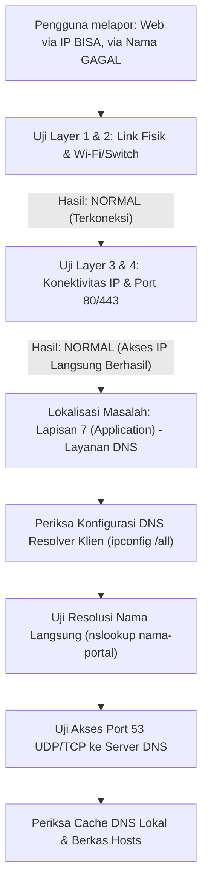
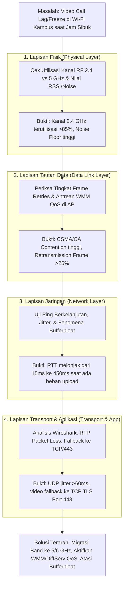
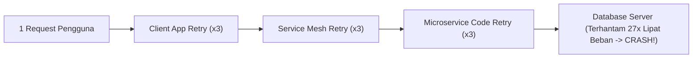

# Tugas Modul 2 — Model Referensi OSI dan TCP/IP
**Mata Kuliah:** Konsep Jaringan (TI043102) — D4 Teknik Informatika, PENS  
**Rujukan Modul:** Bab 2 — Model Referensi OSI dan TCP/IP (`computer-and-network-2026`)  
**Format:** Jawaban Lengkap Latihan Soal Level A, Level B, dan Level C

---

## Daftar Isi
- [Level A — Ingatan dan Pemahaman (Soal 1–10)](#level-a--ingatan-dan-pemahaman)
  - [Soal 1: Alasan Komunikasi Jaringan Disusun Berlapis](#soal-1-jelaskan-alasan-komunikasi-jaringan-disusun-berlapis)
  - [Soal 2: Perbedaan Layanan, Antarmuka, dan Protokol](#soal-2-bedakan-layanan-antarmuka-dan-protokol)
  - [Soal 3: Tujuh Lapisan OSI dan Fungsi Utamanya](#soal-3-sebutkan-tujuh-lapisan-osi-dari-bawah-ke-atas-beserta-fungsi-utamanya)
  - [Soal 4: Empat Lapisan Model TCP/IP](#soal-4-sebutkan-empat-lapisan-model-tcpip)
  - [Soal 5: Alasan TCP/IP Disajikan sebagai Lima Lapisan](#soal-5-mengapa-model-tcpip-kadang-disajikan-sebagai-lima-lapisan)
  - [Soal 6: Perbedaan Frame, IP Packet, TCP Segment, dan UDP Datagram](#soal-6-apa-perbedaan-frame-ip-packet-tcp-segment-dan-udp-datagram)
  - [Soal 7: Definisi Header, Trailer, dan Payload](#soal-7-definisikan-header-trailer-dan-payload)
  - [Soal 8: Enkapsulasi dan Dekapsulasi](#soal-8-jelaskan-enkapsulasi-dan-dekapsulasi)
  - [Soal 9: Fungsi Multiplexing dan Demultiplexing](#soal-9-apa-fungsi-multiplexing-dan-demultiplexing)
  - [Soal 10: Mengapa OSI Bukan Spesifikasi Implementasi](#soal-10-mengapa-osi-tidak-boleh-dianggap-sebagai-spesifikasi-implementasi)
- [Level B — Penerapan dan Analisis (Soal 11–20)](#level-b--penerapan-dan-analisis)
  - [Soal 11: Pemetaan Protokol ke Model TCP/IP](#soal-11-pemetaan-protokol-ke-model-tcpip)
  - [Soal 12: Enkapsulasi DNS melalui UDP, IPv4, dan Ethernet](#soal-12-enkapsulasi-permintaan-dns-melalui-udp-ipv4-dan-ethernet)
  - [Soal 13: Enkapsulasi HTTP/3 melalui QUIC dan Kedudukan Transport QUIC](#soal-13-enkapsulasi-http3-melalui-quic-dan-status-transport)
  - [Soal 14: Perubahan Header saat Paket Melewati Router (Non-NAT)](#soal-14-perubahan-dan-ketetapan-header-saat-melewati-satu-router)
  - [Soal 15: Perubahan Header jika Router Melakukan NAT/PAT](#soal-15-perubahan-analisis-jika-router-melakukan-natpat)
  - [Soal 16: Checksum TCP Salah pada Paket Keluar dan NIC Offload](#soal-16-analisis-checksum-tcp-salah-pada-paket-keluar-dan-nic-offload)
  - [Soal 17: Diagnosis Akses Portal via IP Berhasil tetapi via Nama Gagal](#soal-17-diagnosis-portal-dapat-diakses-via-ip-tetapi-gagal-via-nama)
  - [Soal 18: Ping Berhasil tetapi HTTPS Gagal (6 Hipotesis L4–L7)](#soal-18-enam-hipotesis-ketika-ping-berhasil-tetapi-https-gagal)
  - [Soal 19: Perbandingan Sesi Aplikasi vs Koneksi TCP](#soal-19-perbandingan-sesi-aplikasi-dengan-koneksi-tcp)
  - [Soal 20: Alasan Enkripsi Tidak Selalu di Presentation Layer](#soal-20-mengapa-enkripsi-tidak-selalu-pada-presentation-layer)
- [Level C — Evaluasi dan Sintesis (Soal 21–30)](#level-c--evaluasi-dan-sintesis)
  - [Soal 21: Evaluasi Relevansi Model OSI di Era Internet TCP/IP](#soal-21-evaluasi-relevansi-model-osi-di-era-internet-tcpip)
  - [Soal 22: Analisis Keuntungan dan Kerugian Strict Layering serta Cross-Layer](#soal-22-analisis-keuntungan-dan-kerugian-strict-layering)
  - [Soal 23: Prosedur Troubleshooting Video Konferensi Tersendat di Wi-Fi Kampus](#soal-23-prosedur-troubleshooting-video-konferensi-tersendat-di-wi-fi-saat-jam-sibuk)
  - [Soal 24: Desain Skenario Laboratorium Packet Capture yang Etis dan Aman](#soal-24-rancangan-skenario-laboratorium-perekaman-paket-secara-aman)
  - [Soal 25: Urutan Header VXLAN di atas UDP dan IPsec Tunnel serta Risiko MTU](#soal-25-analisis-urutan-header-vxlan-ipsec-dan-risiko-mtu)
  - [Soal 26: Perbandingan Keamanan MACsec, IPsec, TLS, dan E2EE Aplikasi](#soal-26-perbandingan-macsec-ipsec-tls-dan-enkripsi-aplikasi-e2ee)
  - [Soal 27: Penetrasi Multi-Layer pada Firewall, Proxy, dan Load Balancer](#soal-27-bagaimana-firewall-proxy-dan-load-balancer-menantang-prinsip-single-layer)
  - [Soal 28: Evaluasi Penempatan Integritas Berkas Berdasarkan Prinsip End-to-End](#soal-28-evaluasi-fungsi-integritas-berkas-berdasarkan-prinsip-end-to-end)
  - [Soal 29: Analisis Retry Storm Lintas Lapisan](#soal-29-analisis-retry-storm-lintas-lapisan)
  - [Soal 30: Argumen Pemilihan Model Pengajaran Jaringan Pemula](#soal-30-argumen-pemilihan-model-pengajaran-jaringan-pemula)

---

## Level A — Ingatan dan Pemahaman

### Soal 1: Jelaskan alasan komunikasi jaringan disusun berlapis.
**Jawaban:**
Komunikasi jaringan melibatkan serangkaian permasalahan yang sangat heterogen dan kompleks—mulai dari modulasi sinyal fisik pada media transmisi, arbitrase akses media, pengalamatan perangkat lokal, penentuan rute antarsubnet global, pengelolaan keandalan komunikasi antarproses, negosiasi format data, hingga penyediaan antarmuka bagi pengguna akhir. Jika seluruh persoalan ini dibangun sebagai satu mekanisme monolitik, sistem jaringan akan mustahil untuk dikembangkan, diuji, dipelihara, dan distandarisasi.

Penyusunan arsitektur secara berlapis (*layered architecture*) didasari oleh lima alasan utama:
1. **Modularitas (*Modularity*):** Masalah besar dipecah menjadi modul-modul lapisan yang lebih kecil dengan batasan tanggung jawab yang terdefinisi dengan jelas (*separation of concerns*). Setiap lapisan hanya berkonsentrasi pada tugas spesifiknya.
2. **Interoperabilitas (*Interoperability*):** Standarisasi antarmuka dan protokol per lapisan memungkinkan perangkat keras dan perangkat lunak dari vendor yang berbeda dapat saling berkomunikasi secara mulus asalkan mematuhi standar protokol yang sama.
3. **Evolusi Independen (*Independent Evolution*):** Teknologi pada satu lapisan dapat diganti atau ditingkatkan tanpa harus mendesain ulang lapisan lainnya, selama antarmuka layanan (*service interface*) tetap dipertahankan. Misalnya, transisi media fisik dari kabel tembaga UTP ke serat optik atau Wi-Fi sama sekali tidak menuntut perubahan pada protokol aplikasi seperti HTTP atau protokol transport seperti TCP.
4. **Kemudahan Pengujian dan Penelusuran Gangguan (*Troubleshooting*):** Gejala kesalahan dapat diisolasi ke lapisan tertentu secara terstruktur (menggunakan metode *bottom-up*, *top-down*, atau *divide-and-conquer*), mempercepat proses diagnosis masalah jaringan.
5. **Penggunaan Kembali (*Reusability*):** Satu protokol pada lapisan bawah (seperti IP) dapat melayani berbagai protokol lapisan atas (TCP, UDP, ICMP), dan sebaliknya satu protokol aplikasi (seperti HTTP) dapat berjalan di atas beragam teknologi tautan dan fisik (Ethernet, Wi-Fi, 4G/5G, Fiber).

---

### Soal 2: Bedakan layanan, antarmuka, dan protokol.
**Jawaban:**
Tiga konsep pokok ini sering tertukar dalam percakapan informal, namun secara arsitektur memiliki definisi dan orientasi relasi yang sangat berbeda:

| Aspek | Layanan (*Service*) | Antarmuka (*Interface*) | Protokol (*Protocol*) |
|---|---|---|---|
| **Definisi** | Kemampuan atau fungsionalitas yang disediakan oleh suatu lapisan kepada lapisan yang berada tepat di atasnya. | Titik temu atau mekanisme operasional bagi lapisan atas untuk mengakses layanan yang disediakan lapisan bawah pada mesin yang sama. | Kumpulan aturan, sintaksis, semantik, format pesan, dan urutan waktu pertukaran data antara dua entitas sejawat. |
| **Pertanyaan Inti** | *Apa* yang disediakan lapisan ini? | *Bagaimana* cara lapisan lokal mengakses layanan tersebut? | *Bagaimana* entitas sejawat saling berbicara dan memahami pesan? |
| **Arah Relasi** | **Vertikal**: Dari lapisan bawah ke lapisan atas. | **Vertikal lokal**: Antarlapisan di dalam sistem/komputer yang sama. | **Horizontal logis**: Antarlapisan yang sama pada sistem/komputer yang berbeda. |
| **Contoh Implementasi** | Layanan transfer aliran *byte* andal (*reliable stream*) atau layanan datagram tanpa koneksi (*best-effort*). | *Socket API* (fungsi `socket()`, `connect()`, `send()`, `recv()`), *driver interface*, *system call*. | TCP (RFC 9293), IPv4 (RFC 791), IPv6 (RFC 8200), HTTP/2 (RFC 9113). |

---

### Soal 3: Sebutkan tujuh lapisan OSI dari bawah ke atas beserta fungsi utamanya.
**Jawaban:**
Berdasarkan standar ISO/IEC 7498-1, tujuh lapisan model referensi OSI (*Open Systems Interconnection*) dari lapisan terbawah (Lapisan 1) hingga teratas (Lapisan 7) adalah:

1. **Lapisan 1 — Physical Layer:**  
   Bertanggung jawab atas transmisi bit mentah (*raw bits*) melalui media fisik komunikasi. Mengatur karakteristik mekanik (konektor, pin), elektrik (level tegangan), optik (panjang gelombang cahaya), fungsional, dan prosedural, serta pengodean sinyal (*line coding*) dan sinkronisasi bit.
2. **Lapisan 2 — Data Link Layer:**  
   Bertanggung jawab menyediakan pengiriman data bebas kesalahan melintasi satu tautan fisik atau domain lokal (*hop-to-hop*). Fungsi utamanya meliputi pembentukan *frame* (*framing*), pengalamatan fisik/lokal (*MAC address*), pengendalian akses media (*Media Access Control* / MAC), deteksi kesalahan transmisi (*error detection* via FCS/CRC), dan kontrol aliran lokal.
3. **Lapisan 3 — Network Layer:**  
   Bertanggung jawab atas pengalamatan logis dan penentuan jalur (*routing*) paket melintasi berbagai jaringan heterogen (*end-to-end host delivery*). Mengelola tabel routing, penerusan paket (*forwarding*), fragmentasi/reassembly paket, serta pencegahan perputaran paket tanpa henti (*loop prevention* melalui TTL/Hop Limit).
4. **Lapisan 4 — Transport Layer:**  
   Bertanggung jawab menyediakan komunikasi logis ujung-ke-ujung antarproses aplikasi (*process-to-process communication*). Melakukan *multiplexing/demultiplexing* menggunakan nomor port, segmentasi data aplikasi, serta (pada protokol berorientasi koneksi) menyediakan transfer data yang andal, kontrol aliran (*flow control*), dan kontrol kemacetan (*congestion control*).
5. **Lapisan 5 — Session Layer:**  
   Bertanggung jawab membangun, memelihara, menyinkronkan, dan mengakhiri sesi/dialog pertukaran data antaraplikasi. Mengelola mode komunikasi (simplex, half-duplex, full-duplex) dan menyediakan mekanisme *checkpointing* serta *dialog recovery* agar transfer data panjang dapat dipulihkan dari titik simpan terakhir saat terjadi kegagalan.
6. **Lapisan 6 — Presentation Layer:**  
   Bertanggung jawab mengelola sintaksis dan semantik data yang dipertukarkan agar dipahami secara identik oleh kedua belah pihak. Fungsi pokoknya meliputi representasi data (*data formatting/serialization* seperti JSON, ASN.1, Protobuf), konversi pengodean karakter (ASCII, EBCDIC, UTF-8), kompresi data, dan transformasi kriptografis (enkripsi/dekripsi).
7. **Lapisan 7 — Application Layer:**  
   Lapisan teratas yang langsung berinteraksi dengan proses aplikasi pengguna atau layanan perangkat lunak. Menyediakan protokol jaringan terstandarisasi untuk kebutuhan komunikasi spesifik pengguna, seperti web (HTTP), resolusi nama (DNS), pengiriman surat elektronik (SMTP), dan transfer file (FTP).

---

### Soal 4: Sebutkan empat lapisan model TCP/IP.
**Jawaban:**
Sebagaimana dirumuskan dalam dokumen RFC 1122 dan RFC 1123, arsitektur protokol Internet (model TCP/IP klasik) terdiri atas empat lapisan:
1. **Network Access Layer (sering disebut Link Layer):**  
   Mencakup protokol dan teknologi yang bertugas mengelola pengiriman data pada tautan lokal yang terhubung langsung, mencakup penanganan perangkat keras fisik dan akses media jaringan lokal (contoh: Ethernet, Wi-Fi, PPP, ARP).
2. **Internet Layer:**  
   Menyediakan pengalamatan logis terpadu dan pengantaran datagram tanpa koneksi (*best-effort*) melintasi jaringan-jaringan heterogen (protokol utama: IP, ICMP, IGMP).
3. **Transport Layer:**  
   Menyediakan layanan pengantaran data antarproses aplikasi pada host yang berbeda, baik yang bersifat andal dan berorientasi koneksi (TCP) maupun tanpa koneksi dan minimalis (UDP).
4. **Application Layer:**  
   Mengintegrasikan seluruh fungsi antarmuka aplikasi, manajemen sesi dialog, dan representasi/enkripsi data (contoh protokol: HTTP, DNS, SMTP, SSH, TLS).

---

### Soal 5: Mengapa model TCP/IP kadang disajikan sebagai lima lapisan?
**Jawaban:**
Model TCP/IP kerap disajikan sebagai **model lima lapisan** (*Five-Layer Model*) dalam buku teks standar akademis (seperti Tanenbaum, Kurose & Ross, dan Forouzan) karena alasan pedagogis dan analisis teknik:

1. **Pemisahan Karakteristik Transmisi:**  
   Pada model empat lapisan RFC 1122, *Network Access Layer* menggabungkan aspek perangkat keras transmisi fisik dengan logika *framing* tautan lokal. Padahal, masalah pembentukan bit menjadi sinyal elektrik/optik/radio (Lapisan 1 - Physical) sangat berbeda secara fundamental dari masalah pembentukan frame, pengalamatan MAC, deteksi tabrakan, dan pensaklaran (*switching*) frame (Lapisan 2 - Data Link).
2. **Kesesuaian dengan Industri Perangkat Jaringan:**  
   Perangkat jaringan modern di industri membedakan fungsi secara tegas: media konverter/repeater bekerja murni pada fungsi *Physical*, sedangkan *Ethernet Switch* bekerja pada fungsi *Data Link*. Memisahkan kedua lapisan ini memberikan kerangka berpikir yang lebih akurat untuk menganalisis kegagalan jaringan.
3. **Struktur Lima Lapisan:**  
   Susunan 5 lapisan terdiri atas: (1) Physical, (2) Data Link, (3) Network / Internet, (4) Transport, dan (5) Application. Model ini mempertahankan kesederhanaan lapisan atas TCP/IP sekaligus mengadopsi ketegasan pemisahan lapisan bawah dari model OSI.

---

### Soal 6: Apa perbedaan frame, IP packet, TCP segment, dan UDP datagram?
**Jawaban:**
Perbedaan keempat istilah Protocol Data Unit (PDU) ini terletak pada lapisan tempat unit data tersebut dibentuk, format header yang menyertainya, serta cakupan fungsinya:

| Karakteristik | Frame | IP Packet (Datagram) | TCP Segment | UDP Datagram |
|---|---|---|---|---|
| **Lapisan** | Lapisan 2 (Data Link) | Lapisan 3 (Network/Internet) | Lapisan 4 (Transport) | Lapisan 4 (Transport) |
| **Cakupan Pengiriman** | Lokal tautan (*hop-to-hop*) dalam satu broadcast domain/LAN. | Global lintas jaringan (*end-to-end host-to-host*). | Ujung-ke-ujung antarproses (*process-to-process*). | Ujung-ke-ujung antarproses (*process-to-process*). |
| **Alamat yang Digunakan** | Alamat fisik/lokal (MAC Address). | Alamat logis global (IPv4 / IPv6 Address). | Nomor port (*Source & Destination Port*). | Nomor port (*Source & Destination Port*). |
| **Sifat Komunikasi** | Dibatasi oleh MTU tautan; memiliki trailer FCS/CRC. | *Connectionless*, *best-effort*; routing hierarkis. | *Connection-oriented*, andal, urut (*ordered*), ada *acknowledgment*. | *Connectionless*, tidak andal, berbasis pesan (*message-oriented*). |
| **Informasi Khas Header** | Preamble, MAC Asal/Tujuan, EtherType, CRC/FCS. | TTL/Hop Limit, Protocol, Flag DF/MF, IP Asal/Tujuan. | Sequence Number, Ack Number, Flags (SYN/ACK/FIN/RST), Window. | Panjang UDP (UDP Length), Checksum (Header minimalis 8 byte). |

---

### Soal 7: Definisikan header, trailer, dan payload.
**Jawaban:**
1. **Header:**  
   Informasi kendali (*control information*) yang diletakkan di **bagian depan (awal)** suatu unit data oleh protokol pada lapisan tertentu saat proses enkapsulasi. Header berisi metadata operasional yang dibutuhkan oleh entitas sejawat untuk memproses data tersebut, seperti alamat sumber dan tujuan, nomor port, nomor urut (*sequence number*), pengenal tipe muatan (*protocol identifier*), nilai batas masa hidup paket (TTL), dan bendera kendali (*flags*).
2. **Trailer:**  
   Informasi kendali yang diletakkan di **bagian belakang (akhir)** suatu unit data. Penggunaan trailer paling lazim ditemukan pada Lapisan Data Link (seperti Frame Check Sequence / FCS pada frame Ethernet). Trailer umumnya difungsikan untuk memverifikasi integritas bit muatan dan header melalui algoritma pendeteksi eror seperti Cyclic Redundancy Check (CRC), yang baru dapat dihitung setelah seluruh bit payload selesai dialirkan.
3. **Payload:**  
   Data aktual atau muatan bersih yang dibawa oleh suatu Protocol Data Unit (PDU). Bagi lapisan tertentu, payload adalah unit data utuh yang diserahkan dari lapisan tepat di atasnya. Sebagai contoh, sebuah paket IP menganggap segmen TCP utuh sebagai payload-nya; dan segmen TCP menganggap data teks HTTP sebagai payload-nya.

---

### Soal 8: Jelaskan enkapsulasi dan dekapsulasi.
**Jawaban:**
* **Enkapsulasi (*Encapsulation*):**  
  Proses pengemasan data secara bertahap yang terjadi pada **sistem pengirim**, di mana data bergerak turun dari lapisan teratas (Application) menuju lapisan terbawah (Physical). Setiap lapisan membungkus unit data dari lapisan sebelumnya dengan menambahkan informasi kendali berupa **header** (dan pada Data Link ditambahkan pula **trailer**). Unit data yang dihasilkan pada setiap tingkatan menjadi *payload* bagi lapisan tepat di bawahnya.
* **Dekapsulasi (*Decapsulation*):**  
  Proses kebalikan dari enkapsulasi yang terjadi pada **sistem penerima**, di mana sinyal fisik diubah kembali menjadi bit, dan unit data bergerak naik dari lapisan bawah ke lapisan atas. Pada setiap lapisan, entitas protokol membaca informasi kendali pada header miliknya, memvalidasi keabsahan data, mengeksekusi fungsi kendalinya, melepaskan (*stripping off*) header/trailer tersebut, lalu menyerahkan muatan aslinya (*payload*) ke protokol lapisan atas yang sesuai.

```
Pengirim (Enkapsulasi: Turun)           Penerima (Dekapsulasi: Naik)
[ Data Aplikasi ]                 -->   [ Data Aplikasi ]                (Layer 7/Application)
[ L4 Header | Data ]              -->   [ Data ]                         (Layer 4/Transport)
[ L3 Header | L4 Header | Data ]  -->   [ L4 Header | Data ]             (Layer 3/Network)
[ L2H | L3H | L4H | Data | L2T ]  -->   [ L3H | L4H | Data ]             (Layer 2/Data Link)
Bits: 01011001011010101...        -->   Bits: 01011001011010101...       (Layer 1/Physical)
```

---

### Soal 9: Apa fungsi multiplexing dan demultiplexing?
**Jawaban:**
* **Multiplexing:**  
  Fungsi arsitektural yang memungkinkan beberapa aliran data, beberapa protokol, atau beberapa proses aplikasi yang berbeda untuk **menggunakan satu layanan atau saluran komunikasi lapisan bawah yang sama secara bersama-sama**. Sebagai contoh, dalam satu komputer, puluhan tab peramban web, aplikasi percakapan, dan update sistem operasi dapat secara serentak mengirimkan datagram melalui satu antarmuka kartu jaringan dan satu alamat IP yang sama.
* **Demultiplexing:**  
  Proses pemilahan dan pengantaran payload data yang diterima oleh suatu lapisan bawah kepada protokol atau proses aplikasi yang spesifik dan tepat di lapisan atasnya. Agar demultiplexing dapat berjalan, diperlukan **kunci identifikasi (*identifiers*)** yang tercantum pada header lapisan tersebut:
  - Pada Data Link Layer: field *EtherType* (misal `0x0800` untuk IPv4, `0x86DD` untuk IPv6).
  - Pada Network Layer: field *Protocol* pada IPv4 (misal `6` untuk TCP, `17` untuk UDP) atau *Next Header* pada IPv6.
  - Pada Transport Layer: field *Destination Port* (misal port `80`/`443` untuk web, `53` untuk DNS, `22` untuk SSH).

---

### Soal 10: Mengapa OSI tidak boleh dianggap sebagai spesifikasi implementasi?
**Jawaban:**
Sebagaimana ditegaskan dalam dokumen ISO/IEC 7498-1, OSI dirancang sebagai **Model Referensi Dasar (*Basic Reference Model*)**, bukan sebagai spesifikasi teknis implementasi perangkat lunak atau perangkat keras.
1. **Model Konseptual vs Standar Kode:**  
   Model OSI menetapkan pembagian tanggung jawab fungsional secara logis dan batas-batas konseptual antarlapisan. Namun, OSI tidak mendikte bagaimana struktur data diatur dalam memori RAM, bagaimana *System Call API* dipanggil oleh aplikasi, bagaimana kernel mengelola antrean paket (*sk_buff*), atau bagaimana instruksi perangkat keras dieksekusi.
2. **Ketiadaan Implementasi Monolitik Tujuh Lapis:**  
   Dalam dunia nyata, tidak ada tumpukan perangkat lunak modern yang mengimplementasikan tujuh lapisan secara terpisah dan kaku. Lapisan 5, 6, dan 7 dalam implementasi praktis selalu dirangkum dalam ruang aplikasi (*user space*).
3. **Kegagalan Protokol Asli OSI:**  
   Tumpukan protokol yang secara formal dirancang mengikuti spesifikasi OSI (seperti TP0–TP4, CLNP, FTAM, X.400) terbukti terlalu kompleks, boros komputasi, lambat distandarisasi, dan sulit diimplementasikan secara efisien dibandingkan model tumpukan TCP/IP yang dibangun berbasis *running code* dan pragmatisme implementasi. Oleh sebab itu, memperlakukan OSI sebagai cetak biru implementasi sistem adalah sebuah kekeliruan fatal.

---

## Level B — Penerapan dan Analisis

### Soal 11: Pemetaan Protokol ke Model TCP/IP
**Soal:** Petakan HTTP, TLS, TCP, UDP, QUIC, IPv6, ICMP, Ethernet, Wi-Fi, dan DNS ke model TCP/IP. Tandai protokol yang pemetaannya memerlukan penjelasan.

**Jawaban:**

| Protokol | Lapisan Model TCP/IP (4 Layer) | Catatan Pemetaan Khusus |
|---|---|---|
| **HTTP** | Application | Protokol lapisan aplikasi standar untuk transfer dokumen web dan API. |
| **DNS** | Application | Layanan aplikasi pemetaan nama ke IP; menggunakan transport UDP dan TCP port 53. |
| **TLS** *(perlu penjelasan)* | Application (secara enkapsulasi) / Hybrid L4–L7 | *(1) Penjelasan di bawah* |
| **QUIC** *(perlu penjelasan)* | Transport (secara fungsional) / di atas UDP | *(2) Penjelasan di bawah* |
| **TCP** | Transport | Protokol transport berorientasi koneksi dan andal. |
| **UDP** | Transport | Protokol transport datagram tanpa koneksi dan minimalis. |
| **IPv6** | Internet | Protokol utama pengalamatan dan routing global 128-bit. |
| **ICMP** *(perlu penjelasan)* | Internet (secara arsitektur) / Payload IP | *(3) Penjelasan di bawah* |
| **Ethernet** | Network Access (Link) | Standar teknologi tautan fisik dan kontrol akses media berkabel (IEEE 802.3). |
| **Wi-Fi** | Network Access (Link) | Standar teknologi tautan fisik dan kontrol akses media nirkabel (IEEE 802.11). |

#### Protokol yang Memerlukan Penjelasan Mendalam:
1. **TLS (*Transport Layer Security*):**  
   Secara posisi enkapsulasi, TLS berjalan di atas protokol transport (TCP) dan membungkus data aplikasi (seperti HTTP). Namun secara fungsi dalam model OSI, TLS menjalankan fungsi Presentation (enkripsi, dekripsi, negosiasi cipher) dan fungsi Session (manajemen session key, resumption). Dalam model TCP/IP, TLS dianggap sebagai protokol keamanan pendukung yang diintegrasikan di ruang aplikasi sebelum data ditransmisikan ke soket transport.
2. **QUIC (RFC 9000):**  
   Secara posisi enkapsulasi fisik, paket QUIC dibungkus di dalam datagram UDP (Port 443). Namun, **secara fungsional arsitektural QUIC adalah Protokol Lapisan Transport penuh**. QUIC mengimplementasikan mekanisme keandalan, kontrol aliran (*flow control*), kontrol kemacetan (*congestion control*), dan koneksi multi-aliran (*multiplexed streams*) mandiri di ruang pengguna (*user space*). UDP hanya dimanfaatkan sebagai lapisan penembus (*substrate*) agar paket tidak dibuang oleh perangkat *middlebox* (firewall/NAT) di Internet.
3. **ICMP (*Internet Control Message Protocol*):**  
   Pesan ICMP dibungkus langsung di dalam *payload* datagram IP (menggunakan field Protocol = 1 pada IPv4 atau 58 pada IPv6), seolah-olah ICMP adalah protokol transport. Akan tetapi, secara fungsi arsitektural, ICMP adalah bagian integral dari **Internet Layer**. ICMP tidak melayani pertukaran data antarproses aplikasi, melainkan menyediakan mekanisme diagnostik, pelaporan kesalahan transmisi, dan kendali operasional bagi IP itu sendiri.

---

### Soal 12: Enkapsulasi Permintaan DNS melalui UDP, IPv4, dan Ethernet
**Soal:** Gambarkan enkapsulasi permintaan DNS melalui UDP, IPv4, dan Ethernet. Sebutkan pengenal yang digunakan pada setiap batas.

**Jawaban:**

#### Diagram Struktur Enkapsulasi:
```
+-------------------------------------------------------------------------------------------------+
|                                     Ethernet Frame (Layer 2)                                    |
| +-----------------+---------------------------------------------------------+-----------------+ |
| | Ethernet Header |                Ethernet Payload (IPv4 Packet)           | Ethernet Trailer| |
| | (14 Byte)       | +-------------+---------------------------------------+ | (FCS / CRC, 4B) | |
| | [MAC Dst | Src] | | IPv4 Header |       IPv4 Payload (UDP Datagram)     | |                 | |
| | EtherType=0x0800| | (20 Byte)   | +------------+----------------------+ | |                 | |
| |                 | | [IP Dst|Src]| | UDP Header | UDP Payload          | | |                 | |
| |                 | | Protocol=17 | | (8 Byte)   | (DNS Request Query)  | | |                 | |
| |                 | |             | | DstPort=53 | Transaction ID, dsb. | | |                 | |
| +-----------------+ +-------------+ +------------+----------------------+ +-+-----------------+ |
+-------------------------------------------------------------------------------------------------+
```

#### Pengenal (*Identifiers*) pada Setiap Batas Antarlapisan:
1. **Batas Frame (Layer 2) ke Packet (Layer 3):**  
   Pengenal: **Field EtherType** pada Header Ethernet.  
   Nilai: `0x0800` (heksadesimal), yang memberi tahu lapisan Data Link penerima bahwa payload di dalamnya adalah datagram **IPv4**.
2. **Batas Packet (Layer 3) ke Datagram (Layer 4):**  
   Pengenal: **Field Protocol** pada Header IPv4.  
   Nilai: `17` (desimal / `0x11` heksadesimal), yang memberi tahu lapisan Internet bahwa payload harus diserahkan ke penangan protokol **UDP**.
3. **Batas Datagram (Layer 4) ke Pesan Aplikasi (Layer 7):**  
   Pengenal: **Field Destination Port** pada Header UDP.  
   Nilai: `53` (port standar untuk server DNS).
4. **Batas Aplikasi Internal (Pencocokan Query/Response):**  
   Pengenal: **Transaction ID** (16-bit) di dalam Header DNS, yang digunakan oleh klien untuk mencocokkan respon yang datang dengan pertanyaan awal yang dikirimkan.

---

### Soal 13: Enkapsulasi HTTP/3 melalui QUIC dan Status Transport
**Soal:** Ulangi soal sebelumnya untuk HTTP/3 melalui QUIC. Jelaskan mengapa QUIC tetap dapat dianggap transport meskipun menggunakan UDP.

**Jawaban:**

#### Diagram Struktur Enkapsulasi:
```
+-----------------------------------------------------------------------------------------------+
|                                    Ethernet Frame (Layer 2)                                   |
| +-----------------+-------------------------------------------------------+-----------------+ |
| | Ethernet Header |               Ethernet Payload (IP Packet)            | Ethernet Trailer| |
| | (14 Byte)       | +-----------+---------------------------------------+ | (FCS / CRC, 4B) | |
| | EtherType=0x0800| | IP Header |        IP Payload (UDP Datagram)      | |                 | |
| | (atau 0x86DD)   | | (IPv4/v6) | +------------+----------------------+ | |                 | |
| |                 | | Proto=17  | | UDP Header |     UDP Payload      | | |                 | |
| |                 | |           | | (8 Byte)   |  (QUIC Packet)       | | |                 | |
| |                 | |           | | DstPort=443| +------------------+ | | |                 | |
| |                 | |           | |            | | QUIC Header      | | | |                 | |
| |                 | |           | |            | | (CID, Pkt Num)   | | | |                 | |
| |                 | |           | |            | +------------------+ | | |                 | |
| |                 | |           | |            | | Encrypted Payload| | | |                 | |
| |                 | |           | |            | | (TLS 1.3 +       | | | |                 | |
| |                 | |           | |            | |  HTTP/3 Frames)  | | | |                 | |
+-----------------+ +-----------+ +------------+ +-+------------------+-+ +-+-----------------+ |
+-----------------------------------------------------------------------------------------------+
```

#### Pengenal pada Setiap Batas:
* **Batas Layer 2 -> Layer 3:** Field EtherType bernilai `0x0800` (IPv4) atau `0x86DD` (IPv6).
* **Batas Layer 3 -> Layer 4 (Substrat):** Field Protocol/Next Header bernilai `17` (UDP).
* **Batas UDP -> QUIC:** Field Destination Port bernilai `443` (port standar layanan web aman HTTP/3).
* **Batas QUIC -> HTTP/3:** QUIC Connection ID (DCID/SCID) dan Stream ID; muatan frame HTTP/3 didekripsi menggunakan kunci TLS 1.3 yang dinegosiasikan saat inisiasi koneksi QUIC.

#### Mengapa QUIC Tetap Dianggap Protokol Transport Meskipun Menggunakan UDP?
Klasifikasi suatu protokol ditentukan oleh **layanan dan peran fungsional arsitekturalnya**, bukan semata-mata oleh protokol pembungkusnya:
1. **Penyedia Layanan Transport Penuh:** QUIC menyediakan semua layanan yang mendefinisikan lapisan transport: pembentukan sesi koneksi ujung-ke-ujung, segmentasi data, pengendalian aliran (*flow control* berbasis stream dan koneksi), pengendalian kemacetan jaringan (*congestion control* seperti Cubic/BBR), serta retransmisi data yang hilang secara andal.
2. **Penyelesaian Masalah *Head-of-Line (HoL) Blocking*:** Tidak seperti TCP yang memperlakukan semua data sebagai satu aliran *byte* tunggal (sehingga satu paket hilang menahan seluruh aliran), QUIC mendukung banyak aliran independen (*multiplexed streams*) di dalam satu koneksi fisik.
3. **UDP Hanyalah Lapisan Enkapsulasi Penembus (*Substrate Traversal*):** Jika QUIC dirancang sebagai protokol transport baru dengan nomor IP Protocol baru (di luar 6 untuk TCP dan 17 untuk UDP), mayoritas perangkat perantara (*middlebox*, router NAT, firewall korporat) di Internet akan memblokir paket tersebut karena tidak mengenalinya (*protocol ossification*). Dengan membungkus paket QUIC ke dalam header UDP 8-byte dan mengimplementasikannya di *user space*, QUIC dapat langsung melintasi infrastruktur Internet global tanpa perlu menunggu pembaruan kernel OS di miliaran perangkat.

---

### Soal 14: Perubahan dan Ketetapan Header saat Melewati Satu Router
**Soal:** Dua host berada pada subnet berbeda. Jelaskan header mana yang berubah dan tetap ketika paket melewati satu router, dengan mengabaikan NAT.

**Jawaban:**
Ketika sebuah paket bergerak dari Host A (Subnet 1) melalui satu Router (R) menuju Host B (Subnet 2):

```
[ Host A ] -----(Subnet 1: Tautan Ethernet 1)-----> [ Router R ] -----(Subnet 2: Tautan Ethernet 2)-----> [ Host B ]
```

| Bagian Protokol | Status | Rincian Perubahan / Ketetapan |
|---|---|---|
| **Header Data Link (Ethernet Layer 2)** | **BERUBAH TOTAL** | Frame Layer 2 dari Subnet 1 **dilepas dan dimusnahkan** oleh router. Router membuat frame Layer 2 baru untuk Subnet 2:<br>• MAC Address Sumber berubah menjadi alamat MAC antarmuka keluar Router R.<br>• MAC Address Tujuan berubah menjadi alamat MAC Host B (atau gateway berikutnya).<br>• Trailer FCS/CRC dihitung ulang berdasarkan bit frame baru. |
| **Alamat IP Sumber & Tujuan (Layer 3)** | **TETAP** | Alamat IP Sumber tetap IP Host A, dan Alamat IP Tujuan tetap IP Host B. Router meneruskan paket berdasarkan IP tujuan tanpa mengubah identitas host pengirim/penerima (asumsi non-NAT). |
| **Field TTL / Hop Limit (Layer 3)** | **BERUBAH** | Nilai Time-to-Live (pada IPv4) atau Hop Limit (pada IPv6) **dikurangi 1** oleh router untuk mencegah paket berputar selamanya akibat *routing loop*. |
| **Header Checksum IPv4 (Layer 3)** | **BERUBAH** | Karena nilai TTL berkurang 1, router **menghitung ulang** field *Header Checksum* pada header IPv4. (Pada IPv6, field ini ditiadakan). |
| **Header Transport (Layer 4)** | **TETAP** | Seluruh field header TCP/UDP (Source Port, Destination Port, Sequence Number, Window Size, Checksum) tetap utuh dan tidak dimodifikasi oleh router murni. |
| **Payload Aplikasi (Layer 7)** | **TETAP** | Data aplikasi tidak disentuh dan diperlakukan murni sebagai muatan oleh router. |

---

### Soal 15: Perubahan Analisis jika Router Melakukan NAT/PAT
**Soal:** Jelaskan perubahan analisis apabila router tersebut juga melakukan NAT/PAT.

**Jawaban:**
Jika router pada soal nomor 14 menjalankan fungsi **Network Address Translation / Port Address Translation (NAT/PAT atau NAPT)**, asumsi transparansi ujung-ke-ujung (*end-to-end transparency*) runtuh. Analisis perubahan header menjadi sebagai berikut:

1. **Header Lapisan 3 (IP Header) Mengalami Modifikasi Alamat:**
   - **Trafik Keluar (*Outbound*):** IP Sumber privat milik Host A digantikan oleh router menjadi **Alamat IP Publik** milik antarmuka keluar router.
   - **Trafik Masuk Balasan (*Inbound*):** IP Tujuan (yang awalnya diarahkan ke IP publik router) diterjemahkan kembali ke Alamat IP Privat Host A berdasarkan *NAT Translation Table*.
   - Checksum header IP wajib dihitung ulang oleh router.
2. **Header Lapisan 4 (Transport Header) Mengalami Modifikasi Port:**
   - Karena banyak host privat berbagi satu IP publik yang sama, router melakukan *Port Translation* (PAT).
   - **Field Source Port (pada paket keluar):** Router dapat mengganti nomor port sumber TCP/UDP yang dibuat Host A dengan nomor port unik acak yang dialokasikan router dari *pool port*-nya.
   - **Checksum Transport (TCP/UDP Checksum) WAJIB Dihitung Ulang:** Ini merupakan konsekuensi krusial. Checksum TCP dan UDP menyertakan konsep *Pseudo-Header* yang di dalamnya memuat IP Sumber, IP Tujuan, dan Protokol. Karena IP Sumber berubah dan nomor Port berubah, router terpaksa membongkar dan menghitung ulang nilai checksum Layer 4 sebelum meneruskan paket.
3. **Dampak Arsitektural:**
   - Router bukan lagi sekadar pemroses Layer 3 murni, melainkan telah melakukan inspeksi dan modifikasi aktif hingga ke Layer 4.
   - Aplikasi yang menyematkan alamat IP di dalam muatan data Layer 7 (seperti protokol FTP dalam perintah `PORT`, atau protokol VoIP SIP) akan mengalami kegagalan koneksi kecuali jika router memiliki modul khusus bernama *Application Level Gateway* (ALG) untuk ikut mengubah isi payload aplikasi.

---

### Soal 16: Analisis Checksum TCP Salah pada Paket Keluar dan NIC Offload
**Soal:** Sebuah capture menunjukkan checksum TCP salah pada paket keluar, tetapi tidak ada gangguan komunikasi. Ajukan hipotesis yang berkaitan dengan NIC offload.

**Jawaban:**
* **Hipotesis Utama:**  
  Gejala tersebut merupakan artefak visual yang disebabkan oleh fitur akselerasi perangkat keras kartu jaringan yang disebut **TCP Checksum Offload (TX Checksum Offload)** pada antarmuka jaringan pengirim.
* **Mekanisme Penyebab:**
  1. Untuk menghemat siklus komputasi CPU utama pada sistem operasi modern (Windows, Linux), tumpukan TCP/IP kernel tidak menghitung checksum matematis 16-bit saat membentuk segmen TCP. Tugas ini didelegasikan (*offloaded*) ke prosesor khusus (*ASIC/controller*) yang tertanam di kartu jaringan fisik (NIC).
  2. Perangkat lunak penganalisis paket (*packet sniffer*) seperti Wireshark atau `tcpdump` menangkap paket data di tingkat *driver kernel* sistem operasi (melalui NDIS di Windows atau Libpcap di Linux), yaitu **sebelum** paket tersebut benar-benar diserahkan ke hardware NIC.
  3. Pada titik penyadapan ini, field Checksum pada header TCP masih berisi nilai dummy kosong (`0x0000`) atau nilai acak sementara yang belum dihitung. Akibatnya, Wireshark menandai paket keluar tersebut dengan peringatan: `[TCP Checksum Incorrect / Bad Checksum]`.
  4. Begitu paket melintasi chip hardware NIC fisik, ASIC NIC menghitung nilai checksum yang valid dan menulisnya ke dalam header frame sebelum memancarkannya ke kabel.
* **Verifikasi Mengapa Komunikasi Tetap Berhasil:**  
  Paket yang tiba di host penerima membawa checksum yang sah dan benar. Jika rekaman paket dilakukan di sisi host penerima atau switch perantara (*port mirror*), checksum TCP terbukti valid dan tidak ada paket yang dibuang (*dropped*).

---

### Soal 17: Diagnosis Portal Dapat Diakses via IP tetapi Gagal via Nama
**Soal:** Pengguna dapat membuka portal dengan alamat IP, tetapi tidak dengan nama. Gunakan model lapisan untuk menyusun diagnosis.

**Jawaban:**
Dengan memanfaatkan pendekatan berlapis, proses pemecahan masalah dapat dispesifikasikan secara sangat efisien:



#### Langkah Diagnosis Berdasarkan Kerangka Berlapis:
1. **Eliminasi Lapisan 1, 2, 3, dan 4:**  
   Fakta bahwa portal web dapat dibuka menggunakan alamat IP langsung membuktikan bahwa:
   - Sinyal fisik kabel/Wi-Fi berfungsi normal (Layer 1).
   - Pengalamatan MAC lokal dan switching VLAN berfungsi (Layer 2).
   - Jalur routing IP, gateway, dan tabel forwarding berfungsi normal (Layer 3).
   - Handshake transport TCP port 80/443 serta transmisi data HTTP/HTTPS berjalan sukses (Layer 4 & 7 Web).
2. **Lokalisasi Masalah pada Layanan DNS (Application Layer):**  
   Masalah secara mutlak terisolasi pada kegagalan fungsi resolusi nama domain ke alamat IP (**DNS - Domain Name System**).
3. **Prosedur Pengujian Bertahap:**
   - **Langkah 1 (Verifikasi Konfigurasi IP Resolver):** Eksekusi `ipconfig /all` (Windows) atau periksa `/etc/resolv.conf` (Linux). Periksa apakah alamat server DNS sudah terkonfigurasi otomatis melalui DHCP atau manual. Jika alamat DNS kosong atau mengarah ke IP yang salah, perbaiki konfigurasi jaringan.
   - **Langkah 2 (Pengujian Kueri DNS Langsung):** Jalankan perintah `nslookup portal.univ.ac.id` atau `dig portal.univ.ac.id`. Perhatikan pesan eror: apakah *connection timed out*, *server failure (SERVFAIL)*, atau *non-existent domain (NXDOMAIN)*?
   - **Langkah 3 (Pengujian Konektivitas ke Server DNS):** Lakukan ping ke IP DNS server atau uji konektivitas port UDP 53 menggunakan tool seperti `Test-NetConnection -Port 53 <IP_DNS>`. Jika timeout, ada kemungkinan firewall lokal/kampus memblokir port 53 atau server DNS down.
   - **Langkah 4 (Pemeriksaan Cache dan Pemetaan Lokal):** Bersihkan cache lokal dengan `ipconfig /flushdns`. Periksa berkas `hosts` (`C:\Windows\System32\drivers\etc\hosts`) untuk memastikan tidak ada pemetaan statis usang atau entri berbahaya.
   - **Langkah 5 (Verifikasi DNS Server Authoritative):** Jika DNS resolver kampus aktif namun domain tetap gagal di-resolve, periksa apakah record DNS publik (A/AAAA Record) untuk domain portal tersebut pada nameserver authoritative telah kadaluwarsa atau terjadi masalah konfigurasi DNSSEC.

---

### Soal 18: Enam Hipotesis ketika Ping Berhasil tetapi HTTPS Gagal
**Soal:** Ping ke server berhasil, tetapi HTTPS gagal. Susun sedikitnya enam hipotesis pada lapisan Transport hingga Application.

**Jawaban:**
Fakta bahwa uji `ping` berhasil membuktikan bahwa lapisan Physical, Data Link, serta fungsi routing dan penerusan paket ICMP pada Network Layer (Layer 3) antara klien dan server berada dalam kondisi operasional. Namun, keberhasilan ping tidak menjamin layanan aplikasi berjalan. Berikut adalah **enam hipotesis terstruktur** dari lapisan Transport hingga Application:

1. **Hipotesis 1 — Transport Layer (L4): Port 443 Ditutup / Daemon Web Mati**  
   Layanan web server (seperti Nginx, Apache, atau IIS) di host tujuan sedang tidak aktif (*crashed* atau *stopped*), sehingga tidak ada proses soket yang mendengarkan (*listening*) pada port TCP 443. Saat klien mengirim paket `TCP SYN`, server merespons dengan paket `TCP RST, ACK` (koneksi ditolak).
2. **Hipotesis 2 — Network/Transport Layer (L3/L4): Firewall Memblokir Port 443**  
   Perangkat firewall jaringan (atau *Access Control List* pada router/cloud security group) memiliki aturan yang mengizinkan paket ICMP (Echo Request/Reply), namun secara eksplisit menjatuhkan (*drop*) atau menolak (*reject*) lalu lintas segmen TCP yang menuju port tujuan 443.
3. **Hipotesis 3 — Transport Layer (L4): Handshake TCP Gagal Akibat Kelebihan Beban (*SYN Backlog Full*)**  
   Server web sedang mengalami kebanjiran trafik (*overloaded* atau diserang SYN Flood), sehingga antrean *SYN backlog* penuh. Server tidak membalas paket `SYN` dari klien dengan `SYN-ACK`, menyebabkan inisiasi koneksi TCP klien berakhir dengan status *Connection Timeout*.
4. **Hipotesis 4 — Presentation/Security Layer (L6/L7): Ketidakcocokan Negosiasi Kriptografi TLS (*Cipher Mismatch*)**  
   Koneksi TCP pada port 443 berhasil terbentuk, tetapi proses jabat tangan keamanan TLS (*TLS Handshake*) gagal. Klien dan server tidak memiliki kesepakatan versi TLS (misalnya klien hanya mendukung TLS 1.3 sementara server terkonfigurasi hanya menerima TLS 1.2 lama) atau tidak ditemukan algoritma sandi (*cipher suite*) bersama yang kompatibel saat pertukaran pesan *Client Hello* dan *Server Hello*.
5. **Hipotesis 5 — Presentation/Application Layer (L6/L7): Sertifikat Digital TLS Tidak Valid atau Tidak Dipercaya**  
   Server mengirimkan sertifikat digital SSL/TLS yang telah kadaluwarsa (*expired*), nama domain yang diakses tidak cocok dengan *Common Name* atau *Subject Alternative Name* (SAN) pada sertifikat, atau sertifikat ditandatangani oleh Otoritas Sertifikat (CA) privat yang tidak terdaftar dalam *Trust Store* klien. Klien (browser) secara sengaja memutus koneksi TLS dengan mengirimkan pesan peringatan *TLS Fatal Alert*.
6. **Hipotesis 6 — Application Layer (L7): Kesalahan Konfigurasi Virtual Host (SNI) atau Server Error**  
   Klien tidak mengirimkan ekstensi *Server Name Indication* (SNI) yang benar, atau web server di sisi tujuan mengalami kegagalan internal (*HTTP 500 Internal Server Error* / *502 Bad Gateway* di level reverse proxy) dan langsung menutup koneksi sebelum menyajikan halaman web yang diminta.

---

### Soal 19: Perbandingan Sesi Aplikasi dengan Koneksi TCP
**Soal:** Bandingkan sesi aplikasi dengan koneksi TCP. Berikan contoh ketika sesi bertahan setelah koneksi berubah.

**Jawaban:**

#### Perbandingan Komparatif:
* **Koneksi TCP (*Transport Layer - Layer 4*):**  
  Merupakan hubungan komunikasi logis *stateful* jangka pendek yang dibentuk secara ketat oleh kombinasi unik 4 parameter (*4-tuple*): **(IP Sumber, Port Sumber, IP Tujuan, Port Tujuan)**. Koneksi TCP bertanggung jawab atas keteraturan urutan transmisi byte, penanganan paket hilang melalui retransmisi, dan pengendalian kemacetan. Jika salah satu parameter dari 4-tuple tersebut berubah (misalnya IP klien berganti) atau saluran mengalami pemutusan sinyal melampaui batas *keepalive timeout*, maka koneksi TCP seketika itu juga **putus dan mati**.
* **Sesi Aplikasi (*Session/Application Layer - Layer 5/7*):**  
  Merupakan konteks interaksi logis jangka panjang antara pengguna (*user/client*) dan sistem aplikasi. Sesi mencakup status autentikasi login pengguna, hak akses, preferensi, data keranjang belanja pada e-commerce, atau status percakapan. Sesi aplikasi dipertahankan menggunakan pengenal logis abstrak di tingkat aplikasi seperti **Session Cookie, token otentikasi JWT (JSON Web Token), atau Session ID** yang disimpan di memori/basis data server (seperti Redis).

#### Contoh Kasus Nyata Ketika Sesi Bertahan saat Koneksi Berubah:
**Perpindahan Jaringan (*Network Handover*) pada Pengguna Ponsel Pintar:**
1. Seorang mahasiswa sedang mengakses portal akademik kampus dan melakukan login menggunakan laptop/ponsel yang terhubung ke jaringan **Wi-Fi Perpustakaan Kampus** (IP Klien: `10.20.5.45`). Portal memberikan token sesi berupa *HTTP-only Cookie* terenkripsi.
2. Mahasiswa tersebut berjalan keluar gedung perpustakaan ke lapangan terbuka sehingga sinyal Wi-Fi terputus total. Ponselnya secara otomatis mengalihkan koneksi data ke jaringan **Seluler 4G/5G Operator** (IP Klien berganti total menjadi IP publik operator: `114.125.80.12`).
3. Seluruh koneksi TCP lama yang terikat dengan IP `10.20.5.45` **rusak dan mati secara permanen**.
4. Saat mahasiswa tersebut menekan menu "KRS" pada browsernya, peramban membuka **koneksi TCP baru** dengan alamat IP seluler yang baru menuju web server portal. Pada permintaan HTTP GET yang baru tersebut, browser menyertakan kembali token *Cookie* sesi lama di header HTTP.
5. Server web menerima koneksi baru ini, membaca token sesi, memvalidasi bahwa sesi login mahasiswa tersebut masih aktif, dan langsung menyajikan halaman KRS tanpa meminta mahasiswa memasukkan username dan password ulang. Sesi aplikasi berhasil bertahan melintasi pergantian koneksi transport dan antarmuka fisik.

---

### Soal 20: Mengapa Enkripsi Tidak Selalu pada Presentation Layer
**Soal:** Jelaskan mengapa enkripsi tidak dapat selalu ditempatkan secara mutlak pada Presentation layer.

**Jawaban:**
Menempatkan enkripsi secara mutlak pada *Presentation Layer* adalah simplifikasi historis buku teks klasik yang tidak relevan dengan arsitektur keamanan jaringan komputasi modern. Dalam kenyataannya, enkripsi dapat dan harus diterapkan pada berbagai tingkatan lapisan yang berbeda, tergantung pada **vektor ancaman, domain kepercayaan (*trust boundaries*), dan aset yang dilindungi**:

```
+-------------------------------------------------------------------------------------------------+
| Tingkatan Enkripsi | Titik Penerapan Protokol   | Aset yang Dilindungi | Siapa yang Masih Melihat Metadata? |
+--------------------+----------------------------+----------------------+------------------------------------+
| Layer 2 (Link)     | MACsec (802.1AE)           | Seluruh isi frame    | Tidak ada di kabel lokal           |
| Layer 3 (Network)  | IPsec (Tunnel/Transport)   | Seluruh paket IP     | Router pengirim & penerima tunnel  |
| Layer 4-6 (Session)| TLS 1.3 / QUIC Crypto      | Data aliran aplikasi | Router melihat IP & Port (L3-L4)   |
| Layer 7 (Aplikasi) | E2EE (PGP, Signal, S/MIME) | Konten data murni    | Server aplikasi hanya relai pesan  |
+-------------------------------------------------------------------------------------------------+
```

1. **Enkripsi Lapisan Tautan / Layer 2 (MACsec - IEEE 802.1AE):**  
   Bekerja pada tautan titik-ke-titik fisik antar perantara switch. Enkripsi ini melindungi frame dari penyadapan fisik pada kabel LAN. Jika enkripsi dipaksakan hanya di Presentation Layer, metadata Layer 2 dan Layer 3 telanjang di kabel LAN dan rentan disadap.
2. **Enkripsi Lapisan Jaringan / Layer 3 (IPsec - RFC 4301):**  
   Bekerja pada tingkat paket IP. Pada *IPsec Tunnel Mode*, seluruh paket data asli (termasuk header transport dan header IP asal/tujuan asli) dienkripsi dan dibungkus di dalam header IP baru. Ini melindungi seluruh komunikasi antar-jaringan (Site-to-Site VPN) secara transparan tanpa disadari oleh aplikasi pengguna.
3. **Enkripsi Lapisan Transport/Session (TLS & QUIC):**  
   Melindungi data aplikasi dalam transit antara dua proses aplikasi yang berinteraksi. TLS mengamankan payload HTTP, namun router perantara di Internet masih diizinkan melihat alamat IP dan nomor port untuk keperluan penerusan dan QoS.
4. **Enkripsi Ujung-ke-Ujung Aplikasi / Layer 7 (End-to-End Application Encryption):**  
   Diterapkan langsung pada objek data oleh aplikasi sebelum diserahkan ke sistem operasi (contoh: WhatsApp Signal Protocol, PGP email). Data tetap terenkripsi bahkan saat berada di memori server perantara *cloud provider*.
5. **Kesimpulan:**  
   Pertanyaan rekayasa yang tepat bukanlah "di layer berapa enkripsi berada", melainkan: *Aset apa yang ingin kita lindungi, di mana batas kepercayaannya, siapa lawan yang diantisipasi, dan informasi kontrol apa yang masih wajib terlihat oleh perangkat perantara agar komunikasi dapat dirutekan.*

---

## Level C — Evaluasi dan Sintesis

### Soal 21: Evaluasi Relevansi Model OSI di Era Internet TCP/IP
**Soal:** Evaluasi pernyataan: “Model OSI tidak lagi relevan karena Internet menggunakan TCP/IP.” Susun argumen akademik yang membedakan model, protokol, dan kegunaan pedagogis.

**Jawaban:**
Pernyataan bahwa *“Model OSI tidak lagi relevan karena Internet menggunakan TCP/IP”* adalah **sebuah pernyataan yang keliru dan reduksionis**. Kekeliruan ini berakar pada ketidakmampuan membedakan secara kritis antara **model referensi konseptual** dengan **tumpukan protokol implementasi teknis**.

#### 1. Perbedaan Model vs Protokol
* **Protokol OSI (*The Protocol Suite*):**  
  Sebagai keluarga protokol implementasi nyata (seperti protokol jaringan CLNP, protokol transport TP0–TP4, dan protokol aplikasi FTAM/X.400), OSI memang **telah punah dan kalah** bersaing di industri komersial melawan TCP/IP. Protokol OSI gagal karena standardisasinya lambat, birokratis, implementasinya memakan memori besar, dan dirancang sebelum adanya komersialisasi PC dan Internet global. Dalam konteks tumpukan protokol operasional di Internet, TCP/IP adalah pemenang mutlak.
* **Model OSI (*The Conceptual Reference Model* - ISO/IEC 7498-1):**  
  Sebagai model referensi abstrak, OSI tetap menjadi **kerangka kerja taksonomi konseptual paling komprehensif** yang pernah dirancang dalam sejarah ilmu komputer. Model OSI mendefinisikan pembagian fungsionalitas jaringan secara sangat rapi dan universal, independen dari implementasi vendor tertentu.

#### 2. Kegunaan Pedagogis dan Analitis yang Tetap Krusial
1. **Kosakata Standar Industri Global (*Universal Lingua Franca*):**  
   Hingga hari ini, insinyur jaringan, arsitek infrastruktur, dan vendor perangkat keras (Cisco, Juniper, Arista, Palo Alto) berkomunikasi menggunakan taksonomi OSI:
   - Istilah *"Switch Layer 2"*, *"Router Layer 3"*, *"Stateful Layer 4 Filter"*, hingga *"Application Layer Gateway (L7)"* berakar langsung dari hierarki OSI.
   - Seseorang tidak pernah menyebut switch Ethernet sebagai *"Network Access Switch"*, melainkan *"L2 Switch"*.
2. **Keunggulan Pedagogis dalam Memisahkan Fungsi Rendah:**  
   Model TCP/IP menggabungkan fungsi fisik dan tautan data ke dalam *Network Access Layer*. Secara pedagogis bagi mahasiswa pemula, penggabungan ini berbahaya karena mengaburkan perbedaan esensial antara modulasi sinyal fisik/kabel (Layer 1) dengan mekanisme pembentukan frame, pengalamatan MAC, dan algoritma pensaklaran (Layer 2). Model OSI memberikan batas pemisah yang sangat tegas.
3. **Penyusunan Metodologi Pemecahan Masalah (*Troubleshooting Framework*):**  
   Tujuh lapisan OSI menyediakan panduan mental yang sangat presisi dalam mengisolasi sumber kegagalan sistem. Tim jaringan dapat secara terstruktur memisahkan apakah masalah berada pada level transmisi kabel/serat (L1), kesalahan konfigurasi VLAN (L2), salah gateway IP (L3), pemblokiran port firewall (L4), atau eror sertifikat TLS (L6).

#### Kesimpulan Akademik:
Model OSI dan TCP/IP memiliki peran komplementer: **TCP/IP relevan sebagai arsitektur rekayasa protokol operasional nyata (*engineering implementation*), sedangkan Model OSI relevan sebagai model mental dan kerangka analisis teoritis-pedagogis (*intellectual & educational framework*)**. Menghilangkan model OSI akan merusak pemahaman sistemik mahasiswa terhadap prinsip dasar arsitektur jaringan komputer.

---

### Soal 22: Analisis Keuntungan dan Kerugian Strict Layering
**Soal:** Analisis keuntungan dan kerugian *strict layering*. Kapan cross-layer information dapat membantu dan kapan ia merusak modularitas?

**Jawaban:**

#### Definisi Strict Layering:
*Strict Layering* adalah paradigma desain arsitektur jaringan di mana setiap lapisan diposisikan sebagai kotak hitam (*black box*). Suatu lapisan hanya boleh berkomunikasi secara eksklusif dengan lapisan tepat di atas dan di bawahnya melalui antarmuka formal (*well-defined API*), tanpa memiliki pengetahuan atau ketergantungan apa pun terhadap rincian operasional lapisan lainnya.

#### Keuntungan dan Kerugian:
* **Keuntungan:**
  1. *Modularitas Maksimal:* Mengisolasi kompleksitas. Pengembang aplikasi web dapat membangun sistem tanpa perlu memahami apakah data akan ditransmisikan lewat serat optik, tembaga, atau satelit.
  2. *Interoperabilitas dan Kemudahan Pembaruan:* Satu lapisan dapat diganti secara independen (misal transisi IPv4 ke IPv6) tanpa merusak logika pada lapisan transport atau aplikasi.
  3. *Verifikasi Formal dan Standardisasi:* Memudahkan standarisasi protokol oleh badan internasional (IETF, IEEE) karena batas kewenangan protokol sangat jelas.
* **Kerugian:**
  1. *Inefisiensi Kinerja (*Performance Overhead*):* Setiap lapisan menambahkan header sendiri, alokasi buffer terpisah, dan konteks komputasi sendiri. Terjadi duplikasi fungsi fungsional, misalnya pemeriksaan deteksi eror dilakukan di Layer 2 (CRC), Layer 3 (IPv4 Checksum), Layer 4 (TCP Checksum), dan Layer 7 (Application digest).
  2. *Suboptimalitas pada Jaringan Nirkabel/Bergerak:* *Strict layering* mengasumsikan paket hilang selalu disebabkan oleh kemacetan jaringan (*congestion*). Pada kenyataannya, pada jaringan nirkabel/Wi-Fi, paket hilang kerap disebabkan oleh interferensi sinyal radio, bukan kemacetan buffer router.

#### Kapan Cross-Layer Information Sangat Membantu?
Interaksi lintas lapisan (*cross-layer*) sangat bermanfaat pada kondisi lingkungan heterogen atau dinamis tinggi:
1. **Optimasi Video Streaming Adaptif (DASH / HLS di Wi-Fi/5G):**  
   Lapisan aplikasi streaming video membaca informasi metrik *Signal-to-Noise Ratio* (SNR) dan *RSSI* dari Lapisan Fisik/Data Link (L1/L2 Wi-Fi) untuk secara instan menurunkan resolusi video sebelum buffer aplikasi kosong, mencegah terjadinya *buffering*.
2. **Explicit Congestion Notification (ECN - RFC 3168):**  
   Router pada Lapisan 3 mendeteksi antrean buffer mulai penuh dan menandai bit khusus pada header IP. Lapisan 4 (TCP) membaca tanda ini dan menurunkan laju pengiriman (*congestion window*) sebelum paket benar-benar dijatuhkan (*dropped*).

#### Kapan Cross-Layer Information Merusak Modularitas?
Cross-layer merusak sistem jika:
1. **Menciptakan Keterikatan Erat (*Tight Coupling / Spaghetti Architecture*):**  
   Jika aplikasi web dirancang dengan ketergantungan langsung pada ukuran MTU antarmuka fisik kartu jaringan tertentu, maka ketika pengguna berpindah ke koneksi VPN atau jaringan seluler, aplikasi akan mengalami crash atau kegagalan transmisi.
2. **Mempersulit Pemeliharaan Sistem dan Debugging:**  
   Ketika batas lapisan ditembus secara sembarangan, efek samping (*side effects*) sulit dilacak. Pembaruan kecil pada driver kartu jaringan L1/L2 dapat secara tak terduga merusak algoritma enkripsi atau sesi di L7.

---

### Soal 23: Prosedur Troubleshooting Video Konferensi Tersendat di Wi-Fi saat Jam Sibuk
**Soal:** Buat prosedur penelusuran gangguan untuk kasus video konferensi yang tersendat hanya pada Wi-Fi kampus saat jam sibuk. Hubungkan bukti pada sedikitnya empat lapisan.

**Jawaban:**



#### Prosedur Sistematis Berbasis Bukti Empat Lapisan:

1. **Lapisan 1 — Physical Layer (Kualitas Sinyal & Spektrum Radio):**
   * *Aktivitas Diagnosis:* Gunakan penganalisis Wi-Fi (*inSSIDer*, *Wi-Fi Analyzer*, atau telemetri AP controller) untuk mengukur RSSI, SNR, dan utilisasi spektrum frekuensi radio di area ruangan.
   * *Bukti Teknis:* Sinyal pada kanal 2.4 GHz menunjukkan tingkat utilisasi kanal melampaui 85% dengan *channel overlap* tinggi dari belasan AP tetangga. SNR turun di bawah 15 dB akibat banyaknya perangkat mahasiswa yang memancarkan daya RF bersamaan.
2. **Lapisan 2 — Data Link Layer (Kontensi Media IEEE 802.11 & Frame Error):**
   * *Aktivitas Diagnosis:* Periksa statistik antarmuka nirkabel pada dashboard Access Point kampus, khususnya metrik *Frame Retry Rate* dan *Frame Dropped Rate*.
   * *Bukti Teknis:* Akibat mekanisme kontensi CSMA/CA di udara yang padat, tingkat transmisi ulang frame (*frame retry*) melonjak hingga >25%. AP tidak mengaktifkan fitur prioritas antrean *Wi-Fi Multimedia (WMM / 802.11e)*, sehingga frame video konferensi harus mengantre sama rata dengan frame unduhan berkas besar mahasiswa lain.
3. **Lapisan 3 — Network Layer (Latensi Antrean & Bufferbloat pada Gateway):**
   * *Aktivitas Diagnosis:* Lakukan pengujian ping terarah dan pengukuran variasi keterlambatan paket (*jitter*) menuju default gateway router dan server DNS menggunakan parameter `ping -t -l 1000 <Gateway_IP>`.
   * *Bukti Teknis:* RTT (*Round Trip Time*) yang pada kondisi sepi bernilai 10–15 ms membengkak hingga 400–600 ms secara fluktuatif (*bufferbloat*) saat ada lalu lintas puncak. Terdapat *packet loss* sebesar 8–12% pada hop pertama menuju gateway. Router kampus tidak menerapkan penandaan prioritas DSCP (*Differentiated Services*) untuk membedakan paket audio/video dari trafik reguler.
4. **Lapisan 4/7 — Transport & Application Layer (Performa Aliran Media Real-Time):**
   * *Aktivitas Diagnosis:* Buka panel statistik internal aplikasi video konferensi (Zoom/Teams/Meet) dan rekam sampel paket menggunakan Wireshark (filter: `udp.port >= 10000` atau port aplikasi video).
   * *Bukti Teknis:* Terjadi packet loss pada protokol transfer media real-time (RTP di atas UDP) melampaui ambang batas toleransi codec (maksimal 2–3%). Karena UDP loss sangat masif, aplikasi secara otomatis melakukan *fallback* ke mode koneksi TCP port 443 melalui TLS. Pada transport TCP, setiap kali satu paket hilang, mekanisme retransmisi TCP menghentikan pembacaan frame video berikutnya (*Head-of-Line Blocking*), menyebabkan video mengalami *freeze* total selama beberapa detik.

* **Rekomendasi Tindakan Korektif:** Memaksa perangkat mahasiswa bermigrasi ke band frekuensi 5 GHz / 6 GHz (*Band Steering*), mengaktifkan WMM QoS prioritas Voice/Video pada seluruh Access Point, dan menerapkan algoritma manajemen antrean pintar (*FQ-CoDel / Smart Queue Management*) di router gateway untuk memusnahkan fenomena bufferbloat.

---

### Soal 24: Rancangan Skenario Laboratorium Perekaman Paket secara Aman
**Soal:** Rancang skenario laboratorium perekaman paket yang menunjukkan Ethernet, IP, TCP atau UDP, TLS, dan protokol aplikasi tanpa mengumpulkan data sensitif.

**Jawaban:**

#### 1. Tujuan Praktikum
Mahasiswa mampu mengidentifikasi secara empiris struktur enkapsulasi bertingkat: **Ethernet Frame (L2) -> IPv4 Packet (L3) -> TCP/UDP Segment (L4) -> TLS Record (L5/L6) -> HTTP Application Message (L7)** menggunakan perangkat lunak penganalisis protokol Wireshark dalam lingkungan laboratorium yang terkendali dan mematuhi etika privasi.

#### 2. Topologi Jaringan dan Lingkungan Uji
* Komputer Mahasiswa (Klien Lab) terhubung ke jaringan LAN laboratorium terisolasi.
* Server Web Internal Lab beralamat IP `192.168.100.10` menjalankan Nginx dengan HTTPS aktif (port 443).
* Server mempublikasikan satu berkas statis terbuka beralamat `https://lab.internal/public-announcement.txt` yang hanya berisi teks bebas lisensi *"Selamat Datang di Praktikum Konsep Jaringan"*.

#### 3. Prinsip Perlindungan Privasi & Keamanan Data (*Ethical Capture*)
1. **Penetapan Filter Penangkapan Ketat (*Strict Capture Filter*):**  
   Mahasiswa dilarang keras merekam antarmuka yang mengarah ke Internet publik. Capture filter Wireshark wajib disetel hanya merekam komunikasi ke server lab:
   ```text
   host 192.168.100.10 and (port 443 or port 53)
   ```
2. **Peniadaan Data Sensitif:**  
   Tidak ada form input kredensial, username, password, atau identitas mahasiswa. Seluruh objek yang diakses adalah konten statis publik.
3. **Penyuntikan Kunci Sesi Terkendali untuk Dekripsi Edukatif:**  
   Untuk membuktikan keberadaan Lapisan Aplikasi di balik enkripsi TLS tanpa melanggar privasi, mahasiswa mengarahkan *browser key logging* ke berkas sementara di komputer lokal mereka:
   ```bash
   # Windows PowerShell
   $env:SSLKEYLOGFILE="C:\Temp\sslkey.log"
   & "C:\Program Files\Google\Chrome\Application\chrome.exe" --user-data-dir="C:\Temp\ChromeLab"
   ```
   Wireshark dikonfigurasi mengimpor `sslkey.log` agar mahasiswa dapat melihat teks HTTP didekripsi pada jendela terpisah di laptop masing-masing, dan berkas kunci tersebut langsung dihapus permanen di akhir praktikum.

#### 4. Lembar Observasi Bertingkat Mahasiswa
Mahasiswa diminta menelusuri satu paket data keluar dan melengkapi tabel observasi:
* **Frame Layer (L2):** Amati *Destination MAC*, *Source MAC*, dan nilai *EtherType* (`0x0800`).
* **IPv4 Layer (L3):** Amati *Source IP* (`192.168.100.X`), *Destination IP* (`192.168.100.10`), *TTL*, dan *Protocol* (`6` untuk TCP).
* **TCP Layer (L4):** Amati *Source Port* (dinamis), *Destination Port* (`443`), *Sequence Number*, dan *Flags* (ACK, PSH).
* **TLS Layer (L5/L6):** Amati *TLS Record Layer*, Content Type: *Application Data (23)*, Version: *TLS 1.3*.
* **Decrypted HTTP Layer (L7):** Amati pesan `GET /public-announcement.txt HTTP/1.1` dan kode status `HTTP 200 OK`.

---

### Soal 25: Analisis Urutan Header VXLAN, IPsec, dan Risiko MTU
**Soal:** Sebuah organisasi menggunakan VXLAN di atas UDP dan IPsec tunnel. Gambarkan kemungkinan urutan header dan jelaskan risiko MTU.

**Jawaban:**

#### Skenario Arsitektur:
Organisasi membangun jaringan *Overlay Virtual Extensible LAN (VXLAN)* untuk menghubungkan lalu lintas mesin virtual (VM) antarpusat data, dan seluruh lalu lintas overlay tersebut diamankan melalui terowongan *IPsec Tunnel Mode (ESP)* yang melintasi jaringan publik/underlay.

#### Diagram Urutan Header (Dari Terluar ke Terdalam):
```
+---------------------------------------------------------------------------------------------------+
| 1. Outer Physical Ethernet Header (14 Byte MAC Dst/Src + 4 Byte 802.1Q VLAN jika ada)             |
+---------------------------------------------------------------------------------------------------+
| 2. Outer Underlay IP Header (20 Byte, Alamat IP Publik Gateway VPN Pengirim ke Penerima)          |
+---------------------------------------------------------------------------------------------------+
| 3. IPsec ESP Header (8 Byte SPI & Sequence Number + 8-16 Byte IV tergantung algoritma AES)        |
+---------------------------------------------------------------------------------------------------+
| [BAGIAN TERENKRIPSI OLEH IPSEC DIMULAI DI SINI]                                                  |
| +-----------------------------------------------------------------------------------------------+ |
| | 4. Outer UDP Header for VXLAN (8 Byte, Port Tujuan Standar IANA 4789)                         | |
| +-----------------------------------------------------------------------------------------------+ |
| | 5. VXLAN Header (8 Byte, memuat 24-bit VXLAN Network Identifier / VNI)                        | |
| +-----------------------------------------------------------------------------------------------+ |
| | 6. Inner Original Ethernet Header (14 Byte MAC VM Pengirim & VM Tujuan)                       | |
| +-----------------------------------------------------------------------------------------------+ |
| | 7. Inner Original IP Header (20 Byte IP Privat VM Asal & VM Tujuan)                           | |
| +-----------------------------------------------------------------------------------------------+ |
| | 8. Inner Transport Header (20 Byte TCP atau 8 Byte UDP milik aplikasi VM)                     | |
| +-----------------------------------------------------------------------------------------------+ |
| | 9. Payload Data Aplikasi VM                                                                   | |
| +-----------------------------------------------------------------------------------------------+ |
| | 10. IPsec ESP Trailer (Padding 0-255 Byte + 1 Byte Pad Length + 1 Byte Next Header)           | |
| +-----------------------------------------------------------------------------------------------+ |
| [BAGIAN TERENKRIPSI BERAKHIR DI SINI]                                                             |
+---------------------------------------------------------------------------------------------------+
| 11. IPsec ESP ICV / Auth Tag (Integrity Check Value, biasanya 16 Byte untuk AES-GCM)              |
+---------------------------------------------------------------------------------------------------+
| 12. Outer Frame Check Sequence (FCS / CRC, 4 Byte)                                               |
+---------------------------------------------------------------------------------------------------+
```

#### Analisis Risiko MTU dan Fenomena Path MTU Black Hole:
1. **Akumulasi Overhead Enkapsulasi yang Masif:**  
   - Header IP Luar: 20 byte
   - Overhead IPsec ESP (Header, IV, Trailer, ICV/Tag): ~50 hingga 70 byte
   - Header UDP Luar: 8 byte
   - Header VXLAN: 8 byte
   - Header Ethernet VM Asli: 14 byte
   - **Total Overhead Tambahan:** $\approx \mathbf{100 - 120\text{ Byte}}$.
2. **Risiko Fragmentasi dan Dampak Kinerja:**  
   - Jika MTU antarmuka fisik underlay adalah standar Ethernet Internet (**1500 byte**), maka ukuran paket maksimum yang diizinkan untuk VM internal adalah: $1500 - 120 = \mathbf{1380\text{ Byte}}$.
   - Jika mesin virtual (VM) mengirimkan paket TCP standar dengan ukuran payload 1460 byte (total paket IP VM = 1500 byte), maka setelah dibungkus VXLAN dan IPsec, ukuran paket membengkak menjadi **1620 byte**.
   - Paket berukuran 1620 byte melampaui MTU antarmuka underlay. Gateway IPsec terpaksa melakukan **fragmentasi IP** di lapisan bawah. Fragmentasi membebani CPU router secara drastis, meningkatkan latensi, dan jika satu fragmen hilang di Internet, seluruh paket harus dibuang.
3. **Risiko Path MTU Discovery (PMTUD) Black Hole:**  
   - Jika paket dari VM disetel dengan bit *DF (Don't Fragment)* aktif, router underlay tidak boleh memecah paket dan akan membuang paket tersebut sambil mengirimkan pesan kendali `ICMP Type 3 Code 4 (Fragmentation Needed)`.
   - Banyak firewall di Internet memblokir seluruh paket ICMP secara agresif. Akibatnya, pesan peringatan ICMP tidak pernah sampai ke VM pengirim.
   - Dampaknya adalah **Black Hole Koneksi**: Handshake TCP awal (SYN/ACK) berjalan sukses karena ukurannya kecil (<100 byte), tetapi begitu transfer data besar dimulai, koneksi seketika itu juga membeku (*hang*) tanpa ada pesan eror yang jelas.
4. **Solusi Rekayasa:**
   - Aktifkan **Jumbo Frames** (MTU 9000 atau minimal MTU 1600–1700) pada seluruh rute fisik jaringan underlay antar data center.
   - Terapkan **TCP MSS Clamping** pada gateway router untuk memaksa MSS segmen TCP VM turun ke angka yang aman (misalnya MSS = 1340 byte).

---

### Soal 26: Perbandingan MACsec, IPsec, TLS, dan Enkripsi Aplikasi E2EE
**Soal:** Bandingkan perlindungan MACsec, IPsec, TLS, dan enkripsi end-to-end aplikasi dari sisi cakupan kepercayaan dan titik terminasi.

**Jawaban:**

| Parameter Analisis | MACsec (IEEE 802.1AE) | IPsec (RFC 4301) | TLS 1.3 (RFC 8446) | Enkripsi Aplikasi E2EE (misal: Signal/PGP) |
|---|---|---|---|---|
| **Lapisan Protokol** | Layer 2 (Data Link) | Layer 3 (Network) | Antara Layer 4 & Layer 7 | Layer 7 (Pure Application Layer) |
| **Titik Terminasi (*Endpoints*)** | **Hop-by-hop antarport fisik:** Didekripsi dan dienkripsi ulang di setiap port switch yang terhubung langsung. | **Antar-Gateway atau Host-to-Gateway:** Berakhir di router/firewall batas jaringan VPN. | **Host Klien ke Server Web:** Berakhir di server tujuan atau di reverse proxy / load balancer. | **Ujung Perangkat Pengguna Akhir:** Kunci privat murni berada di tangan pengguna pengirim dan penerima. |
| **Cakupan Kepercayaan (*Trust Domain*)** | Hanya mempercayai media kabel lokal antar 2 perangkat yang bersebelahan. | Mempercayai seluruh infrastruktur internal LAN di belakang gateway VPN. | Mempercayai server web aplikasi dan infrastruktur hosting backend. | **Zero-Trust Infrastructure:** Tidak mempercayai router, ISP, penyedia cloud, maupun server pengelola aplikasi. |
| **Apa yang Masih Terlihat oleh Pihak Ketiga di Jaringan Luar?** | Hanya preamble dan penanda MACsec (seluruh isi frame termasuk MAC asli terenkripsi). | IP Header Luar (alamat IP publik gateway pengirim dan penerima VPN). | Alamat IP pengirim/penerima, nomor port transport (443), ukuran data, dan SNI (jika tanpa ECH). | Metadata jaringan lengkap (IP, Port, waktu kirim, volume trafik, dan ID pengguna). |
| **Kerentanan Titik Lemah (*Weak Points*)** | Data tidak terlindungi begitu masuk ke dalam chip pensaklaran internal switch; rentan jika switch diretas. | Data terbuka (*plaintext*) saat melintasi jaringan lokal kampus/kantor setelah keluar dari gateway VPN. | Data terbuka di memori internal web server dan backend database; rentan terhadap inspeksi *TLS Offloading*. | Memerlukan manajemen kunci pengguna yang rumit; metadata komunikasi masih rentan terhadap analisis intelijen (*traffic analysis*). |

---

### Soal 27: Bagaimana Firewall, Proxy, dan Load Balancer Menantang Prinsip Single-Layer
**Soal:** Jelaskan bagaimana firewall, proxy, dan load balancer menantang anggapan bahwa setiap perangkat hanya membaca header lapisannya.

**Jawaban:**
Materi dasar jaringan sering menyederhanakan bahwa perangkat jaringan bekerja secara kaku pada satu lapisan tertentu: switch pada Layer 2, router pada Layer 3, dan server pada Layer 7. Dalam infrastruktur komputasi modern, anggapan ini **sepenuhnya runtuh** akibat keberadaan peralatan cerdas perantara (*middleboxes*):

1. **Stateful Inspection & Next-Generation Firewall (NGFW):**
   - Firewall modern tidak hanya membaca alamat IP (L3) dan port (L4) untuk mengambil keputusan pemblokiran.
   - NGFW melakukan **Deep Packet Inspection (DPI)**: membongkar payload aplikasi hingga Layer 7. Firewall membedakan apakah lalu lintas port 80/443 adalah penelusuran web legal, panggilan API, transfer database, atau aktivitas malware.
   - Banyak firewall NGFW menerapkan fitur *SSL/TLS Decryption*: firewall secara sengaja memutus enkripsi TLS, memeriksa muatan Layer 7 terhadap virus dan kebocoran data (DLP), lalu mengenkripsi ulang paket menuju server tujuan. Tindakan ini merambah seluruh lapisan dari L3 hingga L7 secara simultan.
2. **Reverse Proxy & Application Gateway:**
   - Proxy mematahkan paradigma pengantaran paket transparan. Proxy bertindak sebagai **terminator koneksi penuh**.
   - Ketika klien mengirim permintaan web, proxy menerima frame L2, membaca IP L3, menyelesaikan handshake TCP L4, dan menyelesaikan jabat tangan TLS L6. Proxy kemudian mendestrukturisasi pesan HTTP di Layer 7 untuk membaca header, cookie autentikasi, dan URL tujuan.
   - Proxy kemudian membuat **koneksi TCP dan sesi baru yang sama sekali terpisah** menuju server backend. Router di Internet menganggap klien berkomunikasi dengan server, padahal klien hanya berkomunikasi dengan proxy.
3. **Layer 7 Load Balancer (Application Load Balancer - ALB):**
   - Berbeda dengan load balancer Layer 4 murni yang hanya melakukan *round-robin* berdasarkan pasangan IP:Port, ALB beroperasi penuh di Layer 7.
   - ALB membaca konten pesan HTTP di dalam muatan data: memeriksa path URI (misal `/api/v1/checkout` diarahkan ke cluster server performa tinggi, sedangkan `/images/` diarahkan ke cluster server storage murah), membaca header bahasa peramban, dan memeriksa cookie sesi pengguna.
4. **Implikasi Desain:**
   Model OSI dan TCP/IP harus dipahami sebagai **abstraksi peran fungsional logis**, bukan pembatasan perangkat keras fisik. Satu perangkat fisik modern dapat mengeksekusi logika L2 hingga L7 di dalam satu rangkaian *pipeline* pemrosesan paket berkecepatan tinggi.

---

### Soal 28: Evaluasi Fungsi Integritas Berkas Berdasarkan Prinsip End-to-End
**Soal:** Gunakan prinsip end-to-end untuk mengevaluasi penempatan fungsi pemeriksaan integritas berkas pada router, transport, atau aplikasi.

**Jawaban:**

#### Prinsip End-to-End (Saltzer, Reed, & Clark, 1984):
Prinsip *End-to-End Arguments in System Design* menyatakan bahwa:
> *"Fungsi tertentu hanya dapat diimplementasikan secara lengkap dan benar dengan pengetahuan dan partisipasi penuh dari aplikasi pada sistem titik akhir (endpoints). Menyediakan fungsi tersebut sebagai fitur bawaan di jaringan perantara mungkin dapat membantu performa, namun tidak pernah dapat menggantikan verifikasi final pada titik ujung."*

#### Evaluasi Tiga Opsi Penempatan Fungsi Integritas Berkas:

```
[ Disk Klien ] -> (L7 Hash) -> [ L4 TCP ] -> [ L3 Router ] -> [ L4 TCP ] -> (L7 Hash) -> [ Disk Server ]
     ^                                                                                         ^
     +========================= VERIFIKASI AKHIR END-TO-END ===================================+
```

1. **Opsi 1 — Pemeriksaan Integritas pada Router / Lapisan Jaringan:**
   - *Evaluasi:* **Tidak Memadai dan Salah Tempat.**
   - Router hanya memeriksa integritas frame per tautan fisik menggunakan *Frame Check Sequence (CRC32)* di Layer 2, atau *Header Checksum* pada header IPv4.
   - *Kelemahan Fatal:* CRC pada Layer 2 dilepas setiap kali frame tiba di router. Paket kemudian berada di memori RAM router sebelum dibungkus ke frame baru. Jika terjadi kerusakan bit (*bit flip*) pada chip memori RAM router atau *bus transfer* internal router, router akan menghitung ulang nilai CRC baru yang valid atas data yang telah korup tersebut! Router tidak memiliki visibilitas apakah keseluruhan berkas telah utuh atau rusak.
2. **Opsi 2 — Pemeriksaan Integritas pada Lapisan Transport (TCP Checksum):**
   - *Evaluasi:* **Membantu Optimasi Transmisi, tetapi Tidak Lengkap sebagai Penjamin Integritas Berkas.**
   - TCP memiliki field Checksum 16-bit untuk mendeteksi kerusakan bit segmen selama transit di jaringan.
   - *Kelemahan Fatal:*
     - Algoritma checksum matematis 16-bit TCP sangat lemah terhadap galat jamak (*multiple-bit errors*) pada berkas berukuran gigabyte (probabilitas kegagalan deteksi galat sekitar $1 : 2^{16} = 1 : 65.536$).
     - Yang paling krusial, TCP checksum hanya melindungi data saat berada di dalam tumpukan protokol jaringan (*network socket buffer*). TCP tidak dapat mendeteksi jika berkas mengalami korupsi saat dibaca dari harddisk/SSD pengirim, korupsi saat melewati memori sistem operasi, atau kegagalan penulisan saat berkas disimpan ke storage di server penerima.
3. **Opsi 3 — Pemeriksaan Integritas pada Lapisan Aplikasi (Digest Kriptografis End-to-End):**
   - *Evaluasi:* **Satu-satunya Penempatan yang Lengkap dan Benar.**
   - Aplikasi pengirim menghitung tanda tangan ringkasan berkas (*cryptographic hash* seperti SHA-256) langsung dari berkas asli di media penyimpanan.
   - Berkas ditransmisikan melintasi jaringan. Setelah aplikasi penerima selesai mengunduh dan menulis berkas ke media penyimpanannya sendiri, aplikasi penerima menghitung ulang hash SHA-256 berkas tersebut.
   - Jika nilai hash identik, dijamin 100% bahwa berkas yang tersimpan di disk penerima benar-benar identik dengan berkas asli di pengirim, bebas dari gangguan kabel, bebas dari eror memori router, dan bebas dari cacat tumpukan driver sistem operasi.

#### Kesimpulan:
Pemeriksaan integritas pada L2/L4 berfungsi sebagai *kinerja pendukung* (agar paket rusak segera dibuang tanpa memboroskan bandwidth), tetapi verifikasi integritas berkas final **wajib diletakkan secara mutlak pada Lapisan Aplikasi (End-to-End)**.

---

### Soal 29: Analisis Retry Storm Lintas Lapisan
**Soal:** Analisis potensi retry storm ketika aplikasi, service mesh, dan client sama-sama melakukan pengulangan. Jelaskan mengapa masalah ini bersifat lintas lapisan.

**Jawaban:**

#### Mekanisme Terjadinya Retry Storm (Badai Pengulangan):
*Retry Storm* adalah fenomena kegagalan berantai (*cascading failure*) di mana gangguan performa kecil atau keterlambatan sesaat pada suatu komponen sistem terdistribusi diamplifikasi secara eksponensial oleh mekanisme pengulangan otomatis (*retries*) yang bekerja secara tidak sinkron pada berbagai tingkatan arsitektur, hingga akhirnya melumpuhkan seluruh infrastruktur.

#### Skenario Amplifikasi Multi-Lapisan:
Bayangkan arsitektur sistem berbasis mikroservis cloud modern:
1. Sebuah server database backend mengalami perlambatan mendadak (misalnya karena proses *garbage collection* atau *lock contention*), sehingga waktu respon meningkat dari 50 ms menjadi 2.000 ms.
2. **Lapisan 4 (Transport Layer - TCP Kernel):** Karena acknowledgment (ACK) terlambat datang melampaui estimasi RTO (*Retransmission Timeout*), tumpukan TCP kernel melakukan **retransmisi segmen 2–3 kali**.
3. **Lapisan 7 Infrastruktur (Service Mesh - Envoy / Istio Proxy):** Proxy service mesh menganggap request HTTP mengalami timeout karena belum menerima balasan dalam 1.000 ms. Kebijakan *retry* service mesh disetel melakukan **3 kali pengulangan**.
4. **Lapisan 7 Logika Aplikasi Internal (Backend Microservice):** Library HTTP client internal di kode mikroservis frontend mendeteksi pemanggilan API gagal/timeout dan mengeksekusi fungsi `retry(count=3)`.
5. **Lapisan 7 Klien Pengguna (Web/Mobile App):** Peramban atau aplikasi ponsel pengguna mendeteksi loading terlalu lama, memicu mekanisme retry otomatis kode JavaScript sebanyak **3 kali**.
6. Pengguna manusia yang frustrasi menekan tombol *Refresh* peramban berulang kali.

#### Dampak Multiplikasi Beban:
Tingkat pengulangan ini saling mengalikan (*multiplicative effect*):
$$\text{Beban Trafik} = 1\text{ (Awal)} \times 3\text{ (Client App)} \times 3\text{ (Microservice)} \times 3\text{ (Service Mesh)} = \mathbf{27\text{ Permintaan Duplikat}}$$
Satu permintaan asli dari satu pengguna bermutasi menjadi **27 hingga puluhan permintaan redundan** yang menghujani server database yang sedang sakit. Database yang awalnya hanya mengalami perlambatan sesaat, seketika mengalami lonjakan beban 2.700%, kehabisan memori (*Out-of-Memory*), dan mengalami *crash* total.



#### Mengapa Masalah Ini Bersifat Lintas Lapisan (*Cross-Layer Problem*)?
1. **Kebutaan Lapisan (*Layer Blindness*):**  
   Setiap lapisan beroperasi dalam batas logikanya sendiri tanpa menyadari bahwa lapisan di atas atau di bawahnya telah memiliki mekanisme penanganan kegagalan yang sama. Lapisan transport mengulang paket karena mengira data hilang; lapisan proxy mengulang request karena timeout L7; aplikasi mengulang karena menerima status HTTP 504.
2. **Penyembunyian Status Galat (*Error Concealment*):**  
   *Strict layering* menyembunyikan akar masalah. Service mesh tidak tahu apakah keterlambatan disebabkan oleh antrean TCP di Layer 4, kabel terputus di Layer 1, atau query SQL yang kompleks di Layer 7.
3. **Solusi Rekayasa Berbasis Kesadaran Lintas Lapisan:**
   - Terapkan **Exponential Backoff dengan Jitter Kriptografis** pada seluruh lapisan.
   - Terapkan **Retry Budgeting**: batas maksimum porsi retry (misal tidak boleh lebih dari 10% dari total volume lalu lintas normal).
   - Terapkan **Circuit Breaker** di level service mesh: hentikan seluruh pengiriman request ke backend yang terindikasi sakit (*fail-fast*).
   - Terapkan **Deadline Propagation (Distributed Tracing / gRPC Deadlines)**: batas waktu global disematkan di header pesan dan disinkronkan di semua lapisan; jika batas waktu total 1,5 detik terlampaui, seluruh lapisan otomatis membatalkan operasi tanpa melakukan retry liar.

---

### Soal 30: Argumen Pemilihan Model Pengajaran Jaringan Pemula
**Soal:** Susun argumen apakah materi jaringan pemula sebaiknya memakai model OSI tujuh lapisan, TCP/IP empat lapisan, atau model lima lapisan. Nyatakan tujuan pembelajaran, manfaat, dan keterbatasan pilihan Anda.

**Jawaban:**

#### Pilihan Posisi:
Materi jaringan komputer untuk tingkat pemula (pendidikan diploma dan sarjana ilmu komputer/teknik informatika) **paling ideal dan efektif jika disajikan menggunakan MODEL HIBRIDA LIMA LAPISAN (*Five-Layer Hybrid Model*)**:
1. **Lapisan 5:** Application Layer
2. **Lapisan 4:** Transport Layer
3. **Lapisan 3:** Network Layer (Internet)
4. **Lapisan 2:** Data Link Layer
5. **Lapisan 1:** Physical Layer

#### Tujuan Pembelajaran (*Learning Objectives*):
Membangun fondasi pemahaman konseptual dan praktis mahasiswa yang seimbang: mahasiswa mampu menguasai prinsip rekayasa komunikasi data dari tingkat representasi gelombang/sinyal fisik hingga pemrograman antarmuka aplikasi modern, serta memiliki kesiapan empiris saat melakukan konfigurasi dan analisis perangkat di laboratorium nyata.

#### Analisis Komparatif: Mengapa Menolak Model OSI 7 Lapisan dan TCP/IP 4 Lapisan?
* **Kegagalan Model TCP/IP 4 Lapisan untuk Pemula:**  
  Model 4 lapisan klasik RFC 1122 menggabungkan fungsi fisik dan tautan data ke dalam satu kotak bernama *Network Access*. Pendekatan ini sangat membingungkan mahasiswa pemula. Mahasiswa akan kesulitan memahami di mana letak perbedaan antara kabel tembaga/gelombang radio (aspek fisik L1) dengan kartu jaringan, frame Ethernet, alamat MAC, dan pensaklaran switch VLAN (aspek tautan data L2).
* **Beban Kognitif Berlebih pada Model OSI 7 Lapisan:**  
  Model 7 lapisan memaksa pemula menghafal pemisahan Lapisan 5 (Session), Lapisan 6 (Presentation), dan Lapisan 7 (Application). Dalam praktiknya di dunia nyata Internet, pemisahan ini hampir tidak pernah diwujudkan sebagai entitas protokol yang mandiri. Protokol modern seperti HTTP/2, HTTP/3, TLS, dan format JSON beroperasi sekaligus mencakup aspek sesi, presentasi, dan aplikasi di ruang pengguna (*user space*). Akibatnya, mahasiswa cenderung hanya menghafal definisi tanpa pernah melihat implementasi konkretnya.

#### Manfaat Nyata Model Hibrida Lima Lapisan:
1. **Korespondensi 1-ke-1 dengan Praktikum Laboratorium Empiris:**  
   Susunan 5 lapisan mencerminkan secara tepat apa yang dilihat mahasiswa di layar penganalisis paket (*Wireshark*) dan simulator jaringan (*Cisco Packet Tracer* / *GNS3*):
   - Mahasiswa melihat konektor dan media kabel (L1).
   - Mahasiswa menginspeksi header Frame Ethernet dan tabel CAM switch (L2).
   - Mahasiswa mengonfigurasi IP address, subnet mask, dan routing table router (L3).
   - Mahasiswa menganalisis port TCP/UDP, handshake SYN-ACK, dan kontrol aliran (L4).
   - Mahasiswa melihat pertukaran pesan HTTP, kueri DNS, dan TLS payload (L5).
2. **Kesesuaian dengan Buku Teks Standar Internasional:**  
   Pendekatan 5 lapisan telah diadopsi secara luas oleh buku teks terbaik dunia, seperti Andrew S. Tanenbaum (*Computer Networks*), Kurose & Ross (*Computer Networking: A Top-Down Approach*), dan Behrouz A. Forouzan (*Data Communications and Networking*).
3. **Mengurangi Kebingungan Konseptual (*Cognitive Load Optimization*):**  
   Mahasiswa dapat berkonsentrasi penuh pada pemahaman konsep inti tanpa terdistraksi oleh perdebatan batas teoritis Lapisan 5 dan 6 OSI yang semu.

#### Keterbatasan Model Lima Lapisan dan Mitigasi Pengajarannya:
* *Keterbatasan:*  
  Mahasiswa berisiko tidak mengenal istilah Session dan Presentation saat menghadapi ujian sertifikasi industri tertentu (seperti Cisco CCNA dasar yang masih menanyakan sejarah 7 lapisan OSI) atau saat membaca literatur lama.
* *Strategi Mitigasi:*  
  Pengajar wajib menyajikan **modul komparatif khusus (seperti pada Modul Bab 2 ini)**: menjelaskan bahwa secara historis Model OSI 7 lapisan adalah model referensi formal, dan menjelaskan bagaimana fungsi Session (seperti token otentikasi) dan Presentation (seperti enkripsi TLS dan serialisasi JSON) dilebur secara pragmatis ke dalam Lapisan Aplikasi pada tumpukan Internet modern.

---
*(Dokumen Tugas Modul 2 ini selesai disusun secara lengkap, analitis, dan berbasis standar ilmiah untuk seluruh Soal Level A, Level B, dan Level C).*
