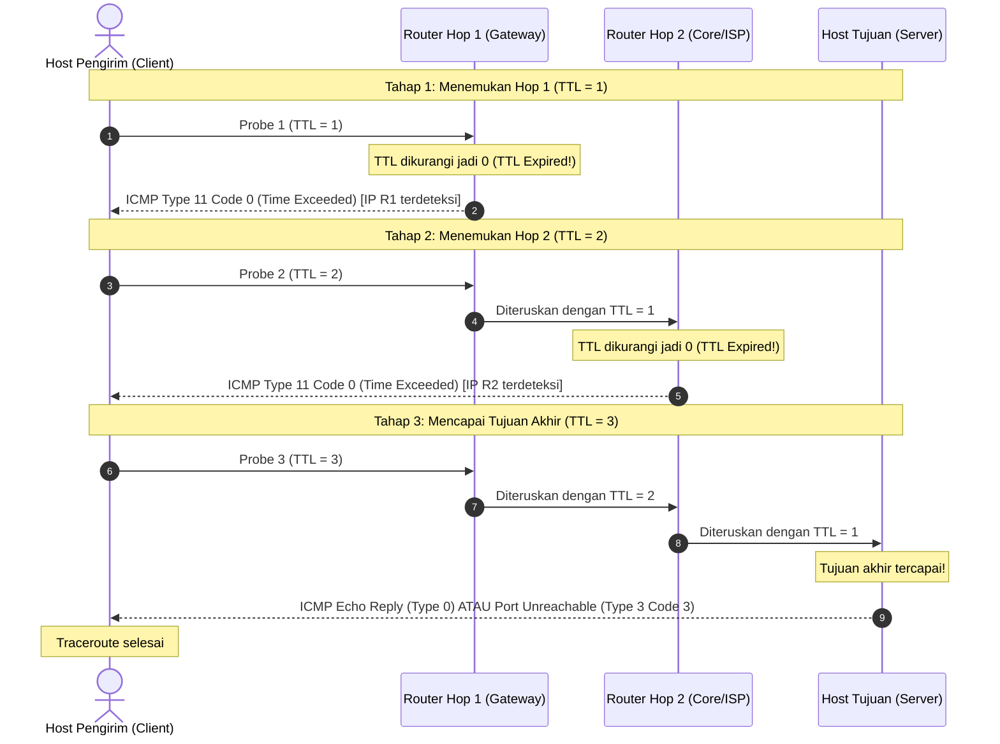

# LAPORAN ANALISIS JARINGAN
## Tugas 5: Analisis Cara Kerja Traceroute & Mekanisme Time-To-Live (TTL)

**Identitas Praktikan:**
- **Nama:** Melodia Bunga Chantika
- **NRP:** 3125600038
- **Mata Kuliah:** Praktikum Konsep Jaringan (Minggu 5 — ICMP & Network Diagnostic)
- **Dosen Pengajar:** Dr. Ferry Astika Saputra, ST, M.Sc
- **Program Studi:** D4 Teknik Informatika, Politeknik Elektronika Negeri Surabaya (PENS)
- **Tahun:** 2026

---

## 1. Pendahuluan & Latar Belakang

Dalam arsitektur protokol Internet (IP / *Internet Protocol*), jaringan beroperasi secara *connectionless* dan *best-effort*. Paket-paket IP (*datagram*) diarahkan secara independen oleh router pada setiap *hop* (*next-hop routing*). Ketika terjadi kesalahan tabel routing (*routing loop*), paket dapat berputar tanpa akhir antar-router, yang berpotensi menghabiskan kapasitas tautan (*bandwidth*) dan membebani antrean router.

Untuk mencegah bencana kemacetan akibat *routing loop*, perancang protokol IP menyematkan mekanisme pertahanan dasar di tingkat *Network Layer*, yaitu *field* **TTL (*Time to Live*)** pada IPv4 (atau **Hop Limit** pada IPv6). Mekanisme ini kemudian dieksploitasi secara cerdas oleh Van Jacobson pada tahun 1988 untuk menciptakan utilitas diagnostik jalur jaringan yang dikenal sebagai **Traceroute** (atau `tracert` pada sistem operasi Windows).

---

## 2. Struktur & Fungsi Field Time-To-Live (TTL)

### 2.1 Format Field TTL pada Header IPv4
Pada header IPv4 standar berukuran 20-byte, field TTL dialokasikan sebesar **8 bit** (berada pada oktet ke-9 dari header IP):

```
 0                   1                   2                   3
 0 1 2 3 4 5 6 7 8 9 0 1 2 3 4 5 6 7 8 9 0 1 2 3 4 5 6 7 8 9 0 1
+-+-+-+-+-+-+-+-+-+-+-+-+-+-+-+-+-+-+-+-+-+-+-+-+-+-+-+-+-+-+-+-+
|Version|  IHL  |Type of Service|          Total Length         |
+-+-+-+-+-+-+-+-+-+-+-+-+-+-+-+-+-+-+-+-+-+-+-+-+-+-+-+-+-+-+-+-+
|         Identification        |Flags|      Fragment Offset    |
+-+-+-+-+-+-+-+-+-+-+-+-+-+-+-+-+-+-+-+-+-+-+-+-+-+-+-+-+-+-+-+-+
|  Time to Live |    Protocol   |        Header Checksum        |
+-+-+-+-+-+-+-+-+-+-+-+-+-+-+-+-+-+-+-+-+-+-+-+-+-+-+-+-+-+-+-+-+
|                       Source Address                          |
+-+-+-+-+-+-+-+-+-+-+-+-+-+-+-+-+-+-+-+-+-+-+-+-+-+-+-+-+-+-+-+-+
|                    Destination Address                        |
+-+-+-+-+-+-+-+-+-+-+-+-+-+-+-+-+-+-+-+-+-+-+-+-+-+-+-+-+-+-+-+-+
```

- **Ukuran:** 8 bit (rentang nilai integer: $0$ s.d. $255$).
- **Nilai Awal Bawaan (*Default Initial TTL*):**
  - Linux Kernel: $64$
  - Microsoft Windows: $128$
  - Cisco IOS / Network Equipment: $255$
- **Hop Limit pada IPv6:** Pada header IPv6, field ini dinamakan secara lebih presisi sebagai **Hop Limit** (juga berukuran 8 bit), menegaskan bahwa fungsinya bukan menghitung waktu detik murni, melainkan menghitung lompatan hop router.

### 2.2 Aturan Operasi Router terhadap Nilai TTL
Setiap kali router Layer 3 menerima paket IP yang ditujukan ke host lain:
1. Router memeriksa nilai TTL pada header IP.
2. Router melakukan pengurangan nilai TTL sekurang-kurangnya satu:
   $$\text{TTL}_{\text{baru}} = \text{TTL}_{\text{lama}} - 1$$
3. Karena field TTL berubah, router wajib menghitung ulang *Header Checksum* pada header IPv4.
4. **Pemeriksaan Kondisi Batas:**
   - Jika $\text{TTL}_{\text{baru}} > 0$: Paket diteruskan ke antarmuka keluaran (*egress interface*) menuju *next hop* berikutnya.
   - Jika $\text{TTL}_{\text{lama}} = 1$ sehingga $\text{TTL}_{\text{baru}} = 0$: Paket **wajib dibuang (*dropped*)** dan router membuat pesan diagnostik **ICMP Time Exceeded** untuk dikirimkan kembali ke alamat IP sumber (*source IP*).

---

## 3. Pesan Kontrol ICMP yang Terlibat

Traceroute sepenuhnya bergantung pada protokol kontrol **ICMP (*Internet Control Message Protocol*)** (RFC 792):

| Jenis Pesan ICMP | Tipe (*Type*) | Kode (*Code*) | Peran dalam Traceroute |
| :--- | :---: | :---: | :--- |
| **Time to Live Exceeded in Transit** | **11** | **0** | Dikirim oleh router perantara ketika mendapati paket dengan $\text{TTL} = 0$. Memberikan identitas IP router perantara tersebut kepada pengirim. |
| **Echo Request** | **8** | **0** | Digunakan sebagai paket probe pada implementasi Windows (`tracert`) atau `traceroute -I`. |
| **Echo Reply** | **0** | **0** | Dikirim oleh host tujuan akhir saat menerima ICMP Echo Request, menandakan akhir dari penelusuran rute. |
| **Destination Unreachable (Port Unreachable)** | **3** | **3** | Dikirim oleh host tujuan akhir pada implementasi Linux/Unix berbasis UDP ketika menerima probe pada port acak tinggi yang tertutup. |

> **Format Muatan Pesan ICMP Time Exceeded (Type 11):**  
> Pesan ini memuat:
> - Header ICMP (Type, Code, Checksum, Unused 4 bytes).
> - **Header IP asli paket pengirim** + **64 bit (8 byte) pertama** muatan asli paket yang dibuang.  
> Informasi ini sangat penting karena memungkinkan pengirim mengidentifikasi nomor probe, port asal, atau sequence number dari probe yang memicu pesan tersebut.

---

## 4. Analisis Langkah demi Langkah Cara Kerja Traceroute

Traceroute bekerja secara bertahap (*incremental hop probing*) dengan sengaja menetapkan nilai TTL yang dimulai dari $1$ dan dinaikkan secara berurutan.



### Penjelasan Rinci Siklus:

1. **Hop 1 ($\text{TTL} = 1$):**
   - Host mengirimkan 3 paket probe berturut-turut dengan $\text{TTL} = 1$.
   - Begitu paket tiba di router pertama (default gateway), router mengurangi TTL menjadi $0$.
   - Router membuang paket dan mengirim balik ICMP *Time Exceeded* (Type 11, Code 0).
   - Host mencatat alamat IP router tersebut dan mengukur selisih waktu kirim dan terima (*Round Trip Time* / RTT) untuk 3 sampel probe.

2. **Hop 2 ($\text{TTL} = 2$):**
   - Host mengirimkan paket probe dengan $\text{TTL} = 2$.
   - Router 1 mengurangi TTL menjadi $1$ dan meneruskannya ke Router 2.
   - Router 2 menerima paket dengan $\text{TTL} = 1$, menguranginya menjadi $0$, membuang paket, dan mengirim ICMP *Time Exceeded*.
   - Host mencatat IP Router 2 beserta 3 nilai RTT.

3. **Hop $N$ ($\text{TTL} = N$ hingga Sampai di Tujuan):**
   - Proses di atas diulang dengan menaikkan nilai TTL sebesar $+1$ pada setiap iterasi hingga paket mencapai host target.

4. **Terminasi / Titik Henti Penelusuran:**
   - Paket diterima oleh host tujuan itu sendiri (bukan router perantara).
   - Host tujuan tidak meneruskan paket ke pihak lain, sehingga ia tidak membuang paket atas dasar TTL habis.
   - Host tujuan merespons sesuai jenis protokol probe yang digunakan (lihat bagian 5). Begitu respons akhir ini diterima oleh host pengirim, proses penelusuran dinyatakan selesai (*Trace complete*).

---

## 5. Perbandingan Implementasi: Windows (`tracert`) vs Linux (`traceroute`)

| Parameter | Windows (`tracert`) | Linux / UNIX / macOS (`traceroute`) |
| :--- | :--- | :--- |
| **Protokol Probe Utama** | **ICMP** (Echo Request, Type 8) | **UDP** (User Datagram Protocol) |
| **Port Tujuan Probe** | Tidak menggunakan port (Layer 3 ICMP murni) | Port tinggi dinamis yang sengaja tidak dipakai (umumnya `33434` - `33534`) |
| **Respons Akhir dari Tujuan** | **ICMP Echo Reply** (Type 0, Code 0) | **ICMP Destination Unreachable: Port Unreachable** (Type 3, Code 3) |
| **Opsi Alternatif** | Terbatas (hanya opsi resolusi nama, hop limit, timeout) | Sangat fleksibel: `-I` (ICMP), `-T` (TCP SYN port 80/443), `-U` (UDP) |
| **Dampak Firewall Perusahaan** | Sering kali di-*drop* oleh firewall ingress korporat yang memblokir ICMP Echo. | Mode TCP SYN (`-T -p 80/443`) mampu menembus firewall yang hanya membuka lalu lintas web. |

---

## 6. Analisis Kasus & Anomali Hasil Traceroute

### 6.1 Mengapa Muncul Tanda Bintang (`* * *` / *Request Timed Out*)?
Simbol bintang pada baris keluaran traceroute sering disalahartikan sebagai putusnya jaringan. Faktanya, beberapa faktor penyebabnya adalah:

1. **Penerapan ACL / Firewall pada Router Hop Tersebut:**  
   Banyak administrator jaringan sengaja mengonfigurasi router (terutama di perimeter ISP/Backbone) untuk tidak merespons ICMP atau mematikan pesan ICMP Time Exceeded demi alasan keamanan (*stealth router*).
2. **ICMP Rate Limiting / Control Plane Policing (CoPP):**  
   Menghasilkan pesan ICMP membutuhkan intervensi CPU kontrol (*Route Processor*) router, bukan ASIC *fast-switching* data plane. Router membatasi pembuatan paket ICMP (misal maksimal 100 paket/detik). Jika beban penuh, probe traceroute diabaikan.
3. **Asymmetric Routing (Jalur Balik Berbeda):**  
   Paket ICMP balasan dari router mungkin melalui rute balik yang berbeda yang mengalami kemacetan atau pemblokiran firewall searah (*asymmetric drop*).

> **Catatan Analisis:**  
> Jika tanda bintang muncul di satu hop (misal Hop 4), tetapi Hop 5 dan seterusnya kembali merespons dengan normal, maka jalur jaringan **sama sekali tidak terputus**. Router Hop 4 hanya menolak merespons paket diagnostik, namun fungsi penerusan data plane-nya berjalan sempurna.

### 6.2 Anomali RTT yang Melonjak di Tengah Jalur
Kadang-kadang hop ke-5 menunjukkan latensi tinggi (misal $120\text{ ms}$), namun hop ke-6 dan ke-7 kembali ke $15\text{ ms}$.  
**Penyebabnya:** Router hop ke-5 memprioritaskan penerusan lalu lintas pengguna di tingkat *hardware forwarding*, dan meletakkan tugas membuat paket ICMP *Time Exceeded* ke antrean prioritas terendah pada CPU perangkat. Oleh karena itu, RTT ICMP tinggi pada hop tunggal bukan indikasi latensi transmisi jaringan yang sebenarnya.

---

## 7. Analisis Berdasarkan Slide Praktikum Minggu 5

Berikut adalah jawaban atas pertanyaan analisis yang tercantum pada materi praktikum:

### Q1: Apa perbedaan fungsi Ping dan Traceroute?
- **Ping:** Berfungsi untuk menguji **keterjangkauan (*reachability*)** ujung-ke-ujung (*end-to-end*) dan mengukur parameter kinerja global (RTT rata-rata, *jitter*, dan persentase *packet loss*) antara dua host. Ping tidak memberikan informasi mengenai rute atau perangkat perantara yang dilalui.
- **Traceroute:** Berfungsi untuk **memetakan jalur hop-by-hop** secara topologis dari host sumber ke host tujuan, mengidentifikasi setiap router perantara yang dilewati, serta melokalisasi pada segmen atau hop ke berapa lonjakan latensi atau kegagalan paket mulai terjadi.

### Q2: Mengapa ping berhasil tidak selalu berarti aplikasi web dapat digunakan?
Keberhasilan Ping hanya memverifikasi bahwa:
1. Lapisan fisik (Layer 1), data link (Layer 2), dan network (Layer 3 / IP routing) berfungsi dengan baik.
2. Protokol ICMP diizinkan oleh host dan firewall.

Namun, keberhasilan Ping **tidak membuktikan ketersediaan aplikasi web** karena:
- Layanan web bekerja pada Layer 7 (HTTP/HTTPS) di atas transport TCP (port 80/443).
- Layanan web server (Nginx/Apache/IIS) bisa saja dalam kondisi mati (*crashed* atau *service stopped*).
- Firewall atau Security Group mungkin mengizinkan ICMP namun memblokir port TCP 80/443.
- Terjadi galat konfigurasi aplikasi web (misal HTTP 500 Internal Server Error, database connection failure).

### Q3: Mengapa Wireshark berguna ketika Ping hanya menunjukkan hasil sukses/gagal?
Ping pada terminal hanya menampilkan status biner (sukses/gagal/timeout) dan nilai RTT. Wireshark memberikan visibilitas mutlak (*ground truth*) di tingkat paket:
- Memeriksa apakah ARP Request dijawab sebelum ICMP dikirim.
- Mengidentifikasi kode error spesifik ICMP yang dikembalikan (misal: *Host Unreachable*, *Network Unreachable*, *Communication Administratively Prohibited* / diblokir firewall).
- Mengetahui apakah kegagalan terjadi di jalur kirim (*Request* tidak sampai) atau jalur pulang (*Reply* tidak kembali).
- Mendeteksi anomali duplikasi paket, fragmentasi IP, atau salah penandaan VLAN Tag (802.1Q).

---

## 8. Kesimpulan

1. **Mekanisme TTL** adalah pondasi keselamatan routing pada jaringan berbasis paket, yang dirancang untuk membunuh paket tersesat (*looping datagram*) agar tidak membanjiri jaringan.
2. **Traceroute** merupakan pemanfaatan kreatif dari pesan kesalahan **ICMP Time Exceeded (Type 11 Code 0)** dengan cara memanipulasi TTL secara inkremental ($1, 2, 3, \dots$).
3. Interpretasi hasil traceroute memerlukan pemahaman mengenai arsitektur perangkat jaringan; ketiadaan respon (`* * *`) pada hop perantara lebih sering disebabkan oleh kebijakan keamanan (*security policy*) atau batasan *control plane* router, bukan kerusakan jaringan fisik.
